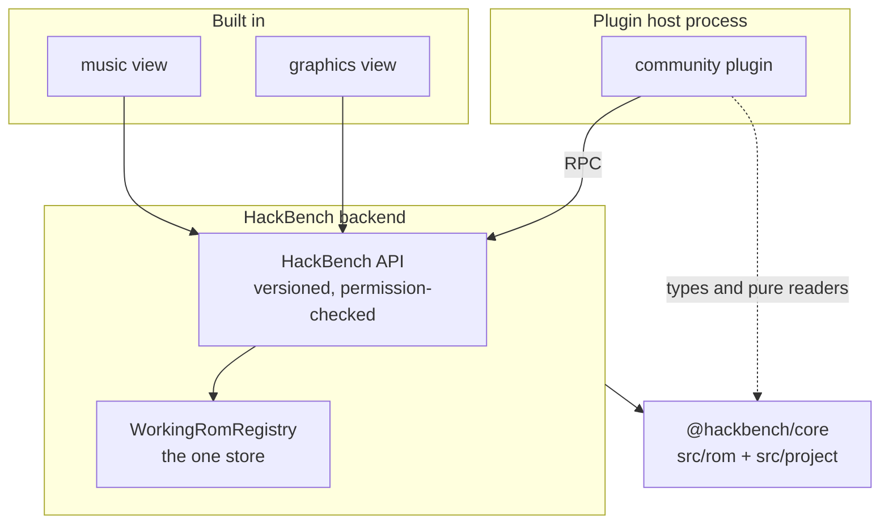

# Deep-dive review, 2026-11-13

Owner-directed third pass: documentation, code and design, with everything on
the table including the language. Two targets were named: map load time, and
whether the flux design supports fast live updates of maps when graphics or
palettes change. A plugin architecture was added as a design track.

Nothing in the product was changed. This file is the only addition.

## Evidence

- Reviewed: `develop` at `0a0dc7ba`, in a worktree.
- Six area reviewers (Opus), each reading its area in full: persistence and
  node servers; core ROM readers and the map model; the 65816 core, sprites
  and object handlers; frontend widgets and protocols; tests, CI and tooling;
  documentation. Each was told to skip what
  [design-review-2026-10-17.md](design-review-2026-10-17.md) and
  [design-review-2026-11-05.md](design-review-2026-11-05.md) already list.
- The map path (`WorkingRom.ts`, `map-screen.ts`, `project-server.ts`,
  `L1Model.ts`, the load path of `map-view-widget.tsx`) was read by the review
  lead, who also re-read two to four leading claims of every reviewer against
  the cited lines.
- Measurements: one-off probe scripts, bundled with esbuild from the session
  scratchpad (not committed), calling the backend map functions directly under
  Node 26.3.1 on a 32-thread Windows 11 machine, one run each, while other
  sessions may have been loading the machine. Nothing was timed in the running
  app, and no Theia build or Playwright run was made.
- One reviewer ran `npm run test:unit` once with the corpus: 13,932 passed, 7
  failed, 50 skipped of 13,989, in 918 s. Four failures are corpus-membership
  tripwires firing on an extra ROM in the local folder (`Kaizo Kindergarten
  v1.09.sfc`); three are timeouts under machine load. Without the corpus, CI
  run 43482442381 at the same commit: 10,810 passed, 3,179 skipped.
- Each finding is tagged: **[M]** measured here, **[V]** read and confirmed by
  the review lead, **[R]** reviewer only.

## Verdict

1. **The store is right; the derived data is the problem.** Ordered layers
   over a read-only base, one working copy, one event bus: keep all of it. But
   nothing between the store and the pixels is a lookup table. The backend
   bakes the palette into RGBA, ships megabytes of base64 per screen, and keys
   every cache on the identity of the whole ROM array, so one palette word
   costs the same as opening every map again.
2. **Map load is slow for three fixable reasons**, in this order: sprites are
   requested before the first screen and block it for 1 to 2 s; the sprite run
   repeats per-ROM work about a dozen times per sprite; the UI-thread
   compositor is about 30 to 50 times slower than the same work needs to be.
3. **Live palette and graphics updates are realistic**, measured: an indexed
   screen builds in 1 to 2.5 ms and recolors in under 1 ms with no backend
   call. Getting there is a representation change, not a language change.
4. **TypeScript is not the wrong language.** The profile is typed-array pixel
   loops and an interpreter, both of which V8 runs well. No hot spot found
   here would be fixed by Rust or WebAssembly and not by the changes below.
   The real platform cost is Theia's IDE packages, which the app ships and
   then suppresses.
5. **The tests are strong where they run, and the two best tiers run only
   after merge.** 23% of unit cases and all of Playwright never run on a PR.
6. **The documentation serves the agent harness first.** About 10% of `docs/`
   is current material for a human contributor.

## 1. Map load time

### Measured

Vanilla ROM, backend functions called directly, cold caches, milliseconds.

| Map | Model build | One screen | All screens | Sprites | Blocks | Start position | Screen JSON |
| --- | --- | --- | --- | --- | --- | --- | --- |
| $105 (20 screens) | 169 | 34 | 406 | 1,272 | 69 | 80 | 1.15 MB |
| $10A (32) | 38 | 7 | 211 | 1,864 | 93 | 86 | 1.73 MB |
| $0F7 (26, vertical) | 50 | 176 | 3,526 | 1,752 | 52 | 104 | 0.68 MB |
| $125 (32) | 48 | 32 | 410 | 1,411 | 156 | 108 | 1.15 MB |
| $1EC (16) | 67 | 29 | 311 | 951 | 129 | 165 | 1.15 MB |

Also: `buildMapTree` (the Maps explorer) 277 to 439 ms; the UI-thread
`composeScreen` 55 to 110 ms per screen (run under Node, same V8); base64
decode about 1 ms per screen. A whole map is 17 to 50 MB of JSON. **[M]**

The app's own nightly measure, `app.open-maps`, reads about 512 ms on $105
([#1321](https://github.com/en-gen/hackbench/issues/1321)); it stops at the
first painted layer of the first screen, so it sees none of the sprite cost
that follows. These numbers are most of the server half of
[#1352](https://github.com/en-gen/hackbench/issues/1352).

### Findings

| # | Finding | Evidence | Fix |
| --- | --- | --- | --- |
| L1 | **Sprites block the first picture.** `open` sends start, details, toolbar art, sprites, collision check and blocks before the first `mapScreen`; every handler is synchronous on one event loop, so screen 0 waits about 1.6 s on $105 for work the first picture does not need. | **[V]** order at `map-view-widget.tsx:453-455`, `:534-550`; **[M]** call costs. Inferred, not timed in the app. Already named in [#1255](https://github.com/en-gen/hackbench/issues/1255). | Request visible screens first; send the sprite request when they have replied. Then move sprite runs off the event loop (a `worker_threads` pool, or per-sprite yields with a cancel check as `mapCollision` does). |
| L2 | **Half the sprite time is the hidden-sprite reveal search.** `findReveal` is 3.2 s of 6.5 s profiled. Each sprite gets about 12 full interpreter runs: one at rest, up to 10 probes, camera probes. | **[M]** profile; **[R]** run count, `RevealSearch.ts:115-122`. | Run the at-rest pass first and return it; run the reveal search as a second, cancellable request. Skip line-snap work when a probe only asks "did it draw". |
| L3 | **A per-ROM stock-code check reruns on every sprite run.** `resolveTables` then `checkExecutePtr` then `notWordTableJump`: a fresh 288 KB machine and about 4,100 steps to re-prove one fact about the ROM. 1.9 s of 6.5 s profiled (30% of sprite time). | **[M]** profile; **[V]** `SpriteRunner.ts:838`, `SpriteDispatch.ts:318-330`. | Cache it per ROM version, as `initTableOf` beside it already is. |
| L4 | **Every run allocates a new machine.** `SpriteBus` allocates 128 KB WRAM, a 128 KB written map and 32 KB SRAM per instance; the constructor alone is 708 ms of self time in the profile, plus the level image copy. | **[M]** profile; **[V]** `SpriteBus.ts:96`, `:114-115`. | One machine per map, reset by dirty list (`TileProbe.ts` already does this). |
| L5 | **The game's level loader reruns for every consumer**: sprites, the collision check, the probe, block contents, sprite frames. Three to five runs per map open, up to 277k steps each. | **[R]** `LevelLoader.ts:307` and its five callers. | Cache the loader image per map and ROM version. |
| L6 | **The compositor allocates about a million small arrays per screen.** `out.set([...])`, `res.map`, `[0,1,2].every` and the arrays `top()` returns, for each of 110,592 pixels. It reruns on every layer toggle and sprite hover. Four visible screens are about 300 ms of UI-thread work. | **[M]** 55 to 110 ms per screen; **[V]** `ColorMath.ts:192-226`. | Scalar accumulators, indexed writes, plane order worked out once per screen. This is independent of [#1068](https://github.com/en-gen/hackbench/issues/1068) (moving it to a worker) and should come first: a 2 ms compositor does not need a worker. |
| L7 | **Vertical maps with an image background draw each screen 13 times over.** The 416-row Layer 2 grid wraps every 512 px, and `drawPlanes` walks every row, so 13 rows land on each visible position. $0F7 costs 176 to 255 ms per screen against 5 to 34 ms for a horizontal map. | **[M]**; **[V]** `map-screen.ts:129-136`, `:216`. | Walk only the rows of one period. |
| L8 | **Start position rebuilds the level catalog twice and the exit graph on every call**, on a fresh ROM copy, uncached: 60 to 165 ms per open. | **[M]**; **[R]** `LevelStart.ts:177`, `:194`. | Cache catalog, overworld entrances and exit graph per ROM version, in one place. |
| L9 | **About 15 to 18 full-ROM pattern scans per cold map build.** `L1ModelCache.get` builds a new `RomFile` per (map, flags), so every `WeakMap<RomFile>` cache in the core starts empty. `findInBytes` is a byte-by-byte JS loop (375 ms self in the profile). | **[V]** `map-screen.ts:578-580`; **[R]** scan count. | Hold one `SmwRom` per ROM version. Anchor scans on `Buffer.indexOf`. |
| L10 | **Toggling a switch palace is a full cold build.** The palace flags are part of the whole model's cache key, though only the object expansion reads them. The cache is first-in-first-out at 8, so an open map can be evicted by previews. | **[V]** `map-screen.ts:573`, `:592`. | Key only the grid by flags; refresh on hit. |
| L11 | **Layer 1 renders every cell from scratch**, through about 1,000 calls and a 1 KB allocation per cell; Layer 2 beside it has a per-tile memo. | **[V]** `map-screen.ts:185-194` against `:226-227`. | Memoize by tile; superseded by section 2. |

### Suggested order

L1, L3, L4, L6 and L7 are small, independent, and need no design decision.
Together they should put tiles on screen in a few hundred milliseconds on
vanilla and cut the sprite run by roughly half (estimate, not measured). L2 and
L5 are the next tier. L9 to L11 fall out of section 2.

## 2. Live updates: is the flux design enough?

### What happens today on one palette-word edit

1. `WorkingRom.applyOnTop` copies the whole ROM into a new array
   (`WorkingRom.ts:351`). **[V]**
2. Every cache downstream is a `WeakMap` keyed on that array or on a `RomFile`
   built from it: map models, BG mode, entrances, palace art, sprite replies,
   block contents, collision replies. All miss. Only the collision
   `ProbeCache` survives, because it records which bytes its results read.
   **[V]**
3. The edit event carries `domain` and byte `ranges`. No view reads either
   (grep of `theia/extension/src/browser` finds no reader). Every subscribed
   view refetches everything. **[V]**
4. Each open map tab calls `refresh()`: details, toolbar art, sprites (every
   sprite re-executed), blocks, collision check, every visible screen.
   **[V]** `map-view-widget.tsx:520-551`.
5. Measured: a map open after an edit costs the same as a cold open, 0.65 to
   2.0 s of sprites plus the model and 1.1 to 1.7 MB per screen. **[M]**
6. For about 2 s after any write, every backend call also re-reads and parses
   every layer file, because the registry only trusts its stamp once all layer
   files are more than 2 s old and nothing refreshes the stamp after its own
   write. **[V]** `WorkingRomRegistry.ts:394-406`.
7. The edit RPC itself builds a full reply that the view always discards,
   because the pushed event arrives first and bumps the view's token. A Map16
   click decodes and ships the whole sheet twice, about 6 MB. Two reviewers
   reported this independently. **[R]** `palette-group-view-widget.tsx:163-166`
   says so in a comment.

### Why #1102 alone does not fix it

[#1102](https://github.com/en-gen/hackbench/issues/1102) gives one shared
computed state per layer version. That removes the per-call ROM copies and
makes the per-ROM caches hit between calls. It still drops everything on every
new version. In flux terms the app has a store and views but no memoized
selectors: nothing knows which bytes a derived result depends on.

### What "lookup tables all the way" needs

Three changes, each useful alone:

1. **Read-set invalidation.** Each derived result records the ROM ranges it
   read. On an edit, the result is kept unless the edit's ranges intersect its
   read set. Two precedents already exist: `ProbeCache.validate` and the
   sprite bus's `romSeen`. `RomFile` is the one place every read goes through,
   so tracking can live there. A pattern scan's result can only change where
   an edit overlaps its match, so scans survive nearly every edit.
2. **Indexed data on the wire.** Send what the hardware holds: per screen, a
   tilemap of 8x8 tile words (about 7 KB for two layers); per tileset, one
   flat table of indexed characters; per map, 256 color words. The client
   composes. A palette edit is then a 512-byte update and a recolor; a
   graphics edit re-sends only the characters of the files it touched; a Map16
   edit re-sends tilemaps. The core reviewer's list of what has to change in
   `src/rom` is short: palettes kept as color words until the edge
   (`PaletteLoader.ts` converts to RGBA at first read today), a flat character
   table, Map16 as raw words, grids as typed arrays.
3. **Versions on events and replies.** An edit RPC returns `{status,
   version}`; the event carries the same version and, for graphics layers, the
   `{file, tile}` list it already has. A view fetches only when its version is
   behind and the domain is one it depends on. This removes the discarded
   replies and the stale-reply tokens every widget hand-rolls.

### Is it realistic? Measured

A probe built Layer 1 of one screen as one palette index per pixel from the
shipped model, then applied the palette through a 256-entry table. **[M]**

| Map | Indexed build | Palette recolor | Shipped RGBA screen (warm) | Pixels differing from shipped Layer 1, screen 0 |
| --- | --- | --- | --- | --- |
| $105 | 1.7 ms | 0.9 ms | 20.5 ms | 0 of 110,592 |
| $125 | 1.0 ms | 0.3 ms | 14.5 ms | 0 |
| $1EC | 2.4 ms | 0.7 ms | 17.2 ms | 0 |
| $001 | 1.0 ms | 0.3 ms | 13.6 ms | 0 |
| $10A | 6.6 ms | 5.5 ms | 11.1 ms | 0 |

Median of 9, one run; $10A's figures were noisy. Scope: Layer 1 only, screen 0
parity only, no ghost cells, sprites or color math. The earlier spike
(`docs/spikes/webgl2-map-renderer-spike.md`) reached the same conclusion from
the other side: the gains come from the indexed representation, not from
WebGL, and the payload is 25 to 151 times smaller raw. A CPU indexed
compositor is enough; WebGL is not needed for this.

Sprites fit the same model: a sprite bitmap is indexed pixels plus a palette
row, and a palette edit does not need the sprite re-run unless the edit
touches bytes the run read.

### Decision this needs

The indexed format was parked on 2026-10-10 and its follow-ups
([#1069](https://github.com/en-gen/hackbench/issues/1069),
[#1070](https://github.com/en-gen/hackbench/issues/1070),
[#1071](https://github.com/en-gen/hackbench/issues/1071)) sit behind 0.1. If
live updates are a product goal, this is the architectural decision to make
before more views are built on RGBA planes: every new overlay written against
RGBA (ghost cells, sprite doors, indicators) is one more thing to port.
`[PROP]` Adopt indexed data plus read-set invalidation as the rendering
contract, and do it as part of #1102, not after it.

## 3. Hack ROMs

The shipped map model builds 488 of 512 maps on vanilla and on the Lunar Magic
resave, and 0 of 512 on each of the five real hacks in the local folder (Grand
Poo World 2 1.1, GrandPooWorld V1.2, Invictus 1.0, Seven Vanilla Levels, Kaizo
Kindergarten v1.09), all on one gate: LoadLevel's boss-mode check is hooked.
**[M]** This is known and by design
([#327](https://github.com/en-gen/hackbench/issues/327), milestone 0.85), and
`MapScreen.test.ts:1143` records it.

It is listed here for two reasons. Every performance number in this review is
vanilla-only, and a 4 MB hack costs more per scan (L9). And it is in tension
with the repo's own rule, "viewers draw; they do not blank": one unreadable
operand refuses the whole map, where the rule asks for a drawn map with an
unverified note. For a ROM-hack editor this is the largest gap between what
the code can do and what a user sees, and the sprite reviewer's suggestion
below (read Layer 1 from the loader's own output) may be the shortest way
through it.

## 4. Design and over-complication

| # | Finding | Evidence |
| --- | --- | --- |
| D1 | **Two rendering architectures share `src/rom/model`.** `SmwMap.render`, `MapBuilder`, `editorStore`, `mapStore`, behaviors and appearances serve only the reference extension; the app draws from `L1Model`, `L2Model`, `ScreenPlanes` and `ColorMath`. The 201-line `src/rom/model/CLAUDE.md` loads for anyone touching the folder and describes the path the app does not use. About 6,400 lines in the sprite reviewer's scope are unreachable from the app, on top of the 105 files the last review counted ([#1100](https://github.com/en-gen/hackbench/issues/1100)). | **[R]**, consistent with the 2026-11-05 count |
| D2 | **The old sprite table engine is plumbed through the shipping path but only a test calls it**: about 3,600 lines (`SpriteDrawEngine`, `SpriteDrawDescriptor`, `SpriteTileLoader`, `GfxRoutineReader`) reachable only through `engineDrawer`, plus dead arms in the result types. | **[R]** `map-sprites.ts:469-486` |
| D3 | **Layer 1 comes from about 7,400 lines of hand ports while the app already runs the game's own level loader for every map.** The loader fills the Layer 1 tile grid in WRAM. The bounded object interpreter draws exactly one handler in production. Reading the grid from the loader image, with the ports as the flagged fallback, would retire most of `standardHandlers.ts` and its hard-coded offsets (61 of 79 standard handlers read operands at fixed offsets with no opcode gate). | **[R]** `interpretedGate.ts:11`, `levelStateVsExpander.test.ts` |
| D4 | **Three 65816 evaluators**: `Cpu65816`, the object interpreter's own decoder, and `HandlerWalk`'s static walker. | **[R]** |
| D5 | **`interpRunner` takes 11 positional parameters**, three call sites pass `undefined, undefined, undefined`, and the reveal search is switched by `run === runWithUploads` in a default. | **[R]** `map-sprites.ts:915-927` |
| D6 | **`ProjectContext.onChanged` means three things**: a project switch, a metadata save and a core change. Saving a title in Project Properties reloads the audio tree, both explorers and the emulator's ROM. | **[R]** `hackbench-contribution.ts:477-493` |
| D7 | **Every widget hand-rolls the same four concerns**: stale-reply tokens, edit subscription, pause when hidden, restore after restart. Each has the fix in some widgets and not others. A shared "project view" base would own them once ([#1105](https://github.com/en-gen/hackbench/issues/1105) covers part). | **[R]** |
| D8 | **The `preview` layer scope is dead code and its documented guarantee is false.** Nothing creates a preview layer; if something did, `persist` would write it to `ops/`. | **[R]** `WorkingRom.ts:48-56`, `OpsStore.ts:58-73` |
| D9 | **Decode logic in the shell keeps growing.** `map-sprites.ts` is 1,569 lines (1,106 at the last review). D101 ruled these modules into core. | **[V]** line count |

## 5. Logic errors and data safety

Not in either earlier review. Hack-only items are marked.

| # | Finding | Evidence |
| --- | --- | --- |
| B1 | **A listener that throws makes an edit report "stale" while the layer stays live in memory and unpersisted.** `invalidate` sets the cache and pushes the layer before the fan-out, with no isolation. | **[V]** `WorkingRom.ts:320-323`; **[R]** registry catch paths |
| B2 | **Per-machine registries are written non-atomically and read leniently.** A torn `roms.json` reads as empty and the next register writes back one entry, dropping every other pairing. There is no single-instance lock, so two app instances race on the same files. | **[V]** no `requestSingleInstanceLock` in `theia/`; **[R]** `RomRegistry.ts:126-141` |
| B3 | **Tabs come back dead after a restart.** Theia's layout restore recreates GFX, Map16 and Overworld widgets without calling `open()`: "Reading the ROM..." forever, and they survive project switches. Only the palette tab guards against it. | **[R]** not reproduced |
| B4 | **Open Recent grows a duplicate "Clear Recently Opened" on every refresh.** | **[V]** `hackbench-contribution.ts:317-358` |
| B5 | **The GFX explorer has no error handling on load** and the GFX service throws where its siblings return a status: the previous project's rows stay up and a click opens them against the new project. | **[R]** `gfx-explorer-widget.tsx:193-195` |
| B6 | **Music play requests race** (no token): two quick clicks can end on the earlier track. | **[R]** |
| B7 | **The collision probe is not abandoned when the registry rebuilds the working copy**; it compares against the old instance. | **[R]** `project-server.ts:185-188` |
| B8 | **The registry never evicts a working copy**, and one module map in `map-collision.ts` keeps the last bytes per ROM path until exit. | **[R]** |
| B9 | **A temp file left by a crash can make atomic writes fail for any later process with the same pid.** | **[R]** `atomicWrite.ts:17-21` |
| B10 | Hack only: **a repointed sprite handler still gets the vanilla name.** The interpreter path never compares resolved pointers with stock ones. | **[R]** `map-sprites.ts:1230-1234` |
| B11 | Hack only: **a block's "Contains" text and the sprite it spawns can come from different tables.** | **[R]** `BlockContents.ts:160-169` |
| B12 | Hack only: **a repointed Layer 3 graphics call makes every level graphics file draw blank with no note.** | **[R]** `GfxLoader.ts:427-445` |
| B13 | Hack only: **the map view omits two "unverified graphics" notes the Map16 sheet shows**, so hooked graphics lists draw stock graphics as fact. | **[R]** |
| B14 | **The collision cache is shared across maps but its seed dependencies are checked only after an edit.** Whether vanilla block code reads a level-varying cell was not traced. | **[R]** |

## 6. Platform: TypeScript, Theia, Electron

- **Language.** Keep TypeScript. The measured costs are a data format (RGBA
  over JSON), cache keys (whole-ROM identity), repeated work (L3 to L5) and
  avoidable allocation (L6, L11). A tight typed-array loop in V8 did the
  indexed screen in about 1 ms. A move to Rust or WebAssembly would cost the
  shared core between Node and the browser and buy nothing these fixes do
  not. What is missing is threads: every heavy backend call runs on the one
  event loop.
- **Strictness.** Only `strict` is on. Measured on `src`:
  `noUncheckedIndexedAccess` 804 errors, `exactOptionalPropertyTypes` 49, the
  other four useful flags 5 in total. ESLint runs without type information, so
  there is no `no-floating-promises` in an RPC-heavy shell. In a byte-table
  parser, an unchecked index is the main bug class. **[R]**
- **Theia earns its place** for docking, commands, trees, dialogs, theming,
  RPC and Electron wiring. What the app pays for and suppresses: Monaco and
  the editor worker with no text editor, the Problems panel with no markers,
  the secondary-window bundle with no undocking, workspace menus it removes,
  four stubbed native addons, and four patches into private Theia internals
  that no unit test can see. **[R]**
- **The app only builds in webpack development mode**, with no production or
  packaging script: a 29 MB main bundle on one existing build. **[V]**
  `theia/electron-app/package.json:26`
- **The Theia app silently depends on the root npm install.**
  `@vue/reactivity` and `@smwcentral/spc-player` are root dependencies only;
  a packaged app or a theia-only install breaks at runtime. **[V]**
- **Binary travels as base64 over a binary channel.** Theia's RPC is msgpack
  and carries `Uint8Array` raw; the emulator service already relies on it.
  **[V]** `rpc-message-encoder.js:47`
- **A window-level, non-passive wheel listener** blocks threaded scrolling in
  every tree and panel while the UI thread is busy, which the compositor (L6)
  makes common. **[R]**

## 7. Tests, gates and CI

| # | Finding | Evidence |
| --- | --- | --- |
| T1 | **Playwright never runs before merge.** 66 files and 616 tests, the layer the project calls acceptance, run nightly in the private validation repo or by manual dispatch. | **[R]** `ci.yml:183-188` |
| T2 | **23% of unit cases never run in CI** (3,179 of 13,989; 103 of 538 files), including 13 of 14 integration files. Some are gated on the ROM for no reason: `SerializeSynthetic.test.ts` gates five fully synthetic blocks. | **[R]** counts from the CI run |
| T3 | **The CI critical path is the coverage step**: 13 min 40 s of about 14.5, on every PR, for a number Codecov treats as informational. One file, `LevelStart.synthetic.test.ts`, takes 321 s because it rebuilds a 4 MB ROM for each of 256 opcodes, twice. | **[V]** `ci.yml:142`; **[R]** timings |
| T4 | **The test and tools trees are not type-checked**: 386 errors out of tree, including fixtures that no longer match product types. | **[R]** |
| T5 | **The core's "no shell imports" rule and the browser's "no Node" rule have no gate.** Both hold today by habit. | **[R]** |
| T6 | **The working-copy gate covers less than the docs claim.** It globs `*-server.ts` only; the modules that actually read the ROM (`map-screen.ts`, `map-sprites.ts`, `map16-decode.ts`, `gfx-decode.ts`) are not scanned, and it matches text. Clean today. | **[V]** `workingCopyGate.test.ts:37` |
| T7 | **Docs-only PRs skip the gates that read docs**, so a PR that breaks them goes green and develop goes red. | **[R]** `ci-changes.mjs:9` |
| T8 | **The shipping app is never built in PR CI.** | **[R]** |
| T9 | **283 fixed sleeps in Playwright**, 61 of them 4 s after shell load in `beforeEach`. The app already emits a `hb:shell-ready` mark. | **[R]** |
| T10 | **The unit suite's result depends on an unversioned folder**: one extra ROM on disk failed four tests in this run. | **[M]** by the reviewer's run |
| T11 | **CI hardening gaps**: `ci.yml` pins actions by tag while the other workflows pin SHAs; no job timeout; no dependency audit; Dependabot does not cover `theia/` (734 packages including Electron). | **[R]** |
| T12 | **About 11% of `test/` tests the agent harness and tooling**, and the perf stack gates nothing while its nightly is not live. | **[R]** |
| T13 | **The reference extension still costs 50 s and a 4 GB heap per PR**, and is the only type-check of `src/webview`, which the app imports from ([#261](https://github.com/en-gen/hackbench/issues/261)). | **[R]** |

The ratio of 1.5 lines of test per line of product buys real safety in the
core: the fail-closed synthetic sweeps are strong. The drag is in text-pinned
workflow tests, regex gates that ESLint rules would do better, and 115
hand-rolled synthetic ROM builders in 69 files.

## 8. Documentation

Checked: about 110 concrete claims. Most hold; `theia-shell.md` is the most
accurate doc in the set.

| # | Finding | Evidence |
| --- | --- | --- |
| X1 | **`CLAUDE.md` describes a session hook that no longer exists** (manual injection by registration). Every agent pays for it on every call. | **[V]** `protocol-inject.mjs:5-8` |
| X2 | **The public CHANGELOG contains the owner's personal email** (line 21), and claims a 0.1.0 release with dead links while the README says there is no release. | **[V]** email; **[R]** release |
| X3 | **Decision ids cannot be resolved from the repo.** 65 distinct D-numbers across 89 files map only to a private memory folder. | **[R]** |
| X4 | **Pre-public issue numbers in docs link to the wrong public issue.** Git history was rewritten to archive references; the docs were not. | **[R]** `theia-shell.md:356` against `:212` |
| X5 | **No doc describes the shipping render pipeline** (D1). | **[R]** |
| X6 | **GitNexus is mandatory in `CLAUDE.md` but its skill files and runner are gitignored**, and the block is duplicated in `AGENTS.md`. | **[V]** `.gitignore:148`, `:154` |
| X7 | **`overview.md`'s edit sequence diagram contradicts the code** (`applyOp` RPC, the store persisting, direct store-to-view notification). `theia-shell.md` has it right. | **[V]** against `WorkingRom.ts:30-31` |
| X8 | **The glossary's Op and Layer are stale** (no mask, no graphics layer), and `project-format.md` omits the graphics layer file shape. | **[V]** `WorkingRom.ts:85` |
| X9 | **Contributors must ship a Playwright test and are not told how to run one.** | **[R]** |
| X10 | **27 of 51 decisions are "Proposed"**, several already shipped and stated as fact elsewhere; the index is in no order. | **[R]** |
| X11 | **Machine-local paths in docs** against the convention that bans them, including the `@`-include of the SNES rulebook that resolves for nobody else. | **[R]** |
| X12 | **Agent manuals disagree on who files issues** (`ba.md` against `overwatch.md` and `planning.md`). | **[R]** |
| X13 | **Comment-to-code ratio exceeds the 0.60 ceiling in 8 of 18 sampled files**, all in `src/rom` plus the protocol; `standardHandlers.ts` has 2,004 comment lines that mostly restate the assembly. | **[R]** |

By line count, about 10% of `docs/` is current contributor reference, 18% ROM
reference, 46% historical or working notes, 21% agent process, 6% decisions.
**[R]** The agent-process material sits at the head of the index and inside
`testing.md`, `CHANGELOG.md` and `CLAUDE.md`. Moving it to its own tree, and
trimming `CLAUDE.md` of the stale hook paragraph, the GitNexus block, the
corpus-move history and the nine-row core table, would cut what every agent
call pays by roughly 40% (reviewer's estimate).

## 9. Plugin architecture

The rulings on [#943](https://github.com/en-gen/hackbench/issues/943) (D70)
stand: runtime plugins for the community, built-in music and graphics views on
the same interface, declared permissions, music first. This section is input
to the design in [#1000](https://github.com/en-gen/hackbench/issues/1000). All
of it is `[PROP]`.

### What blocks a plugin today

1. **The core is not a package.** The extension reaches it through 159
   relative imports (`../../../../src/rom`), with `rootDir` two levels up. A
   plugin author has nothing to depend on.
2. **Layer kinds are a closed union.** `Layer = OpsLayer | GfxLayer |
   UnreadableLayer`; the edit event's `domain` is a closed enum inferred from
   an op's mask. A music tool cannot express its edit.
3. **Edits cannot change size.** Word writes and same-size character edits
   only. Music insertion moves data and needs free space, which is what
   `rom-layout.md` proposes and nobody has built. This is the hard
   dependency, not the plugin loader.
4. **There is no contribution registry** beyond
   `registerSubjectRenderer` in the Properties panel.
5. **The backend is one synchronous event loop.** A plugin that takes a
   second freezes every window (section 1).
6. **The app ships no plugin host.** `@theia/plugin-ext` is not a dependency.

### Shape

1. **`@hackbench/core` as a workspace package**
   ([#391](https://github.com/en-gen/hackbench/issues/391)). No behavior
   change; it fixes the hidden root dependencies (section 6), enables
   incremental builds, and gives plugin authors types and pure readers. A
   music extractor can be written and unit tested against the core alone,
   with synthetic fixtures, before any plugin host exists.
2. **A small API, not Theia's.** A plugin sees:
   - `rom.read(range)` and typed readers over the working copy, never a file
     path and never the base bytes;
   - `edits.propose(layer)`: the only write. The host validates, applies,
     persists and notifies, exactly as for built-in edits, so undo, redo and
     export work with no plugin code;
   - `ui`: commands, a tree section, a properties renderer, file pick and
     save dialogs, progress and cancel;
   - `events.onEdit(filter)` with the versioned event from section 2.
3. **A generic resource layer kind.** `{ kind: 'bytes', owner: '<plugin id>',
   writes: [{ at, old, new }] }` for same-size edits now, with `old` kept for
   portable undo as word ops do. Size-changing edits wait on the resource
   model in `rom-layout.md`; a plugin then proposes a resource replacement and
   the host owns relocation and free space. Unknown kinds already load as
   `UnreadableLayer`, so a project still opens when its plugin is missing.
4. **Runtime loading through Theia's VS Code extension host**, with the
   HackBench API exposed as the plugin's entry object. This gives a separate
   process (which also solves point 5 for plugins), the `.vsix` format and
   Open VSX for free. The cost is adding `@theia/plugin-ext` and its
   dependencies to an app that is already carrying IDE weight; price it
   before committing.
5. **Permissions checked at each call**, not only at install: `rom:read`,
   `edits:write`, `process:run`, `files:export`. The manifest declares them;
   the host refuses anything else.
6. **Copyright stays the host's job.** A plugin can read ROM bytes, so the
   API must make the safe thing the easy thing: extracted music goes out
   through a host-run export dialog with a clear "this file contains ROM
   data" label, and nothing a plugin stores in the project folder may hold
   ROM bytes beyond what a layer's `old` and `new` already do. The content
   gate cannot see a user's project, so this is API design, not a check.

### Worked example: music extract and insert

- **Extract** needs `rom:read` and `files:export`. It is a pure function over
  the working copy and can ship first, on today's layer model.
- **Insert** needs `edits:write` and a size-changing edit. On a vanilla ROM
  the song tables have fixed capacity, so it waits on the resource layout.
  AddmusicK-style insertion that rebuilds the sound engine is `process:run`
  plus a whole-region replacement, and should be scoped as its own decision.
- The existing `MusicService` (catalog, SPC build, aliases) becomes the first
  built-in consumer of the API, which is the test that the API is sufficient.

### Order

Core package, then the versioned event and generic byte layer (both wanted by
section 2 anyway), then the in-process API with the music view moved onto it,
then the runtime host, then the resource layout for size-changing edits.

## 10. Smaller items

- `OpsStore` and `Project.ts` still bypass `atomicWrite.ts`
  ([#225](https://github.com/en-gen/hackbench/issues/225),
  [#243](https://github.com/en-gen/hackbench/issues/243)); still open and
  still the user's work.
- The emulator widget downloads the whole ROM on every project change even if
  never opened, and polls the gamepad every frame for the session. **[R]**
- Export materializes one object per changed byte to count them, for BPS too.
  **[R]** `ExportPatch.ts:21-28`
- A graphics fold copies the ROM tail about 50 times, twice: about 185 MB per
  fold on a 4 MB hack. **[R]** `GfxArena.ts:418`
- Per-machine state lives in Roaming AppData on Windows. **[R]**
- Seven scripts in `tools/` hard-code a home-directory ROM path; five have no
  references. **[R]**
- Accessibility: palette swatches and the Map16 tile browser are mouse-only;
  dialog labels are not associated with their inputs. **[R]**
- Map16, Overworld and GFX repaint whole bitmaps on hover, zoom and unrelated
  updates; the Map16 animation keeps running while its tab is hidden. **[R]**

## Not checked

- Anything in a running build: no Theia build, no Playwright, no Electron.
  The time-to-first-picture claim in L1 is inferred from request order and
  measured call costs.
- Hack ROM performance, because no hack builds a map (section 3).
- Findings tagged **[R]** beyond the spot checks named under Evidence.
- `smw-mcp`, `hackbench-validation` and the 105 reference-only core files.
- Whether any hack-only finding (B10 to B13) occurs on a real hack.
- The agent harness itself (role agents, protocols) beyond the documentation
  contradictions in section 8.
