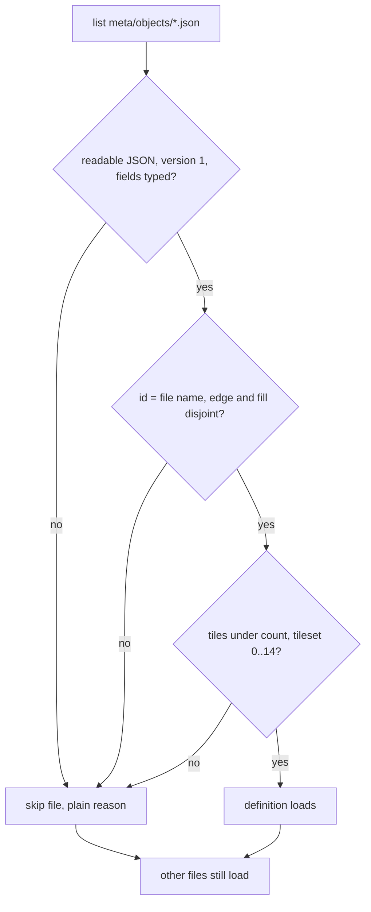

# Object definitions: the saved format

An Object definition is what the Objects activity (#1236) saves and what the
map's Object finder (#1237) reads. The design is in #1234 ("What an Object
is", "Round 1 calls"). This page is the contract between the two: the file, who
may write it, and what a reader may and may not rely on. Words follow
[the glossary](../glossary.md): an **Object** is a definition, or one placed on
a map; a **stored piece** is what the ROM's Layer 1 list holds.

A definition names Map16 tiles. It is project data: it lives in the project's
`meta/`, is never written to the ROM and never becomes a patch layer, and
saving, renaming or deleting one leaves the working copy bytes identical.

## Where it lives

```
<project>/
  meta/
    groups.json
    objects/
      3f9c1a72.json        one file per definition
      b04e77d1.json
```

`meta/objects/` is created on the first save, like `meta/` itself
(`src/project/ProjectMeta.ts:48-51`). A missing folder means "no definitions",
not an error.

One file per definition, not one list like `groups.json`. `groups.json` is read
whole and a damaged one is a single error for the whole file
(`src/project/MapGroups.ts:112-120`); the project server then refuses to
overwrite it (`theia/extension/src/node/project-server.ts:301-312`). With one
file per definition a damaged file takes only itself out, and a save never has
to read, merge or rewrite a file it could not parse.

## The file

UTF-8 JSON, one object, two-space indent and a final newline (what `writeMeta`
produces). File name is `<id>.json`.

```json
{
  "version": 1,
  "id": "3f9c1a72",
  "name": "Floating platform",
  "tileset": 1,
  "edge": [256, 257],
  "fill": [258]
}
```

The numbers are made up. Real ones come from the tileset's Map16 sheet.

| Field     | Type          | Rule                                                                                                                                  |
| --------- | ------------- | ------------------------------------------------------------------------------------------------------------------------------------- |
| `version` | integer       | `1`. Any other value is an unknown version.                                                                                           |
| `id`      | string        | Matches `^[a-z0-9]+(-[a-z0-9]+)*$`, at most 64 characters, and equals the file name without `.json`. Never changes, rename included. |
| `name`    | string        | What the user sees. Not empty after trimming. Not an identity: two definitions may share a name; the id tells them apart.             |
| `tileset` | integer       | The level header's foreground ("object") tileset, as the header stores it. `0` to `14` on a ROM with 15 tilesets (see Ranges).        |
| `edge`    | integer array | Map16 tile numbers tagged as edge. Writers write them sorted, no repeats.                                                             |
| `fill`    | integer array | Map16 tile numbers tagged as fill. Same rule.                                                                                         |

A tile has at most one role, so `edge` and `fill` share no number. Either list
may be empty, because the activity saves a definition while it is being built.
A definition with an empty `edge` loads fine and matches nothing on a map: an
Object needs at least one edge tile (#1234, round 1 call 1). The finder skips
it without a message.

The `id` is generated by the writer when a definition is first saved (for
example eight lowercase hex characters) and is never derived from the name, so
a rename rewrites `name` in place and the file keeps its name. The id is also
the file name, so it is limited to characters that are safe on Windows and
case-insensitive file systems.

### Ranges

- **Tile numbers** are JSON integers from `0` to `count - 1`, where `count` is
  the ROM's foreground Map16 tile count, read with `map16TileCapacity`
  (`src/rom/Map16.ts:668-682`). That is 512 on a stock ROM: pages 0 and 1,
  `$000` to `$1FF`, drawn 16 tiles to a row (`MAP16_TILES_PER_ROW`,
  `theia/extension/src/common/map16-protocol.ts:27`). Every one of them is a
  valid number on every tileset: the sheet is the tileset's whole pointer table
  (`readMap16Table`, `src/rom/Map16.ts:408-448`), some entries being the
  tileset's own and some the shared `Map16Common` run (the sheet's `shared`
  flag, `map16-protocol.ts:226`). So a number is never "outside a tileset" for
  being on the wrong page. Only a number at or past `count` is.
- **Tileset** is `0` to `14` (`TILESET_COUNT`, `src/rom/Map16.ts:42`;
  `MAP16_TILESET_COUNT`, `map16-protocol.ts:26`). The header stores four bits
  (`src/rom/LevelParser.ts:74,186`), so `15` can be written by a hack but this
  ROM has no Map16 table for it, and neither does the Map16 view
  (`isValidTileset`, `theia/extension/src/node/map16-decode.ts:135`).
- The same number looks different on another tileset, which is why the
  definition carries its tileset (#1234, "An Object belongs to one tileset").
  A reader compares `tileset` with the map's header tileset and never reads a
  definition against another one.

## What a reader must do

A reader (the finder, the activity's own list) reads every `*.json` directly
inside `meta/objects/` and ignores everything else: subfolders, leftover
`<id>.json.<pid>.tmp` files from an interrupted write (`atomicWrite.ts:17`),
and anything not ending in `.json`.

A file is **skipped** when any of these hold. The reader keeps going with the
other files, never repairs the file, never rewrites or deletes it, and returns
the reason in plain words next to the file name so the activity can show it:

1. It is larger than 64 KiB, or is not readable JSON.
2. The top level is not an object.
3. `version` is missing or is not `1`: "made by a newer HackBench" is the
   reason offered for a larger number.
4. A field is missing or the wrong type: `id`, `name`, `tileset`, `edge`,
   `fill`; a tile number that is not an integer; a blank name; an `id` that
   breaks the pattern or differs from the file name.
5. A number appears in both `edge` and `fill`.
6. A tile number is below `0` or at or past `count`, or `count` itself is
   unavailable (an expanded or unreadable Map16, `map16TileCapacity`'s
   `reason`): then no definition can be checked, so every one is skipped with
   that reason.
7. `tileset` is outside `0..14`.

When the tile table is unreadable (rule 6), `readObjectDefinitions` still skips
every file with that reason, as above; the Objects activity shows one note for
the whole list instead of one per file. That is presentation only, and readers
are unchanged.

Two files cannot share an `id`, because the id equals the file name. A copied
file under another name fails rule 4 (id differs from file name) and is
skipped.

Order, and repeats inside one list, are not defects: a reader treats `edge`
and `fill` as sets. A reader does not have to sort what it loaded.

`name` is shown as given. A reader never changes a stored file to fix its
formatting. Reading is pure: no read writes anything, so opening a project
with a damaged definition changes nothing on disk.



## What a writer must do

- Write one file per save, `<id>.json`, through `writeFileAtomic`
  (`src/project/atomicWrite.ts:16-41`): a temp file, flushed, then renamed over
  the old one, so a killed process leaves the previous file whole. Create
  `meta/objects/` first; `writeFileAtomic` needs the folder to exist.
- Write `edge` and `fill` sorted ascending with no repeats, disjoint, with
  `version: 1`.
- Never overwrite a file it could not read. Saving definition `x` touches only
  `x.json`; a damaged `y.json` is left exactly as found. Saving over a damaged
  `x.json` is refused in plain words: the user deletes the file or picks
  another name, and the writer never replaces what it could not parse.
- A rename rewrites `name` in the same file and keeps `id`. A delete removes
  the one file.
- Writer-only rules (readers stay as the section above says, and a reader
  never refuses a file for these):
  - Refuse an id that is a reserved Windows file name, in any case: `con`,
    `prn`, `aux`, `nul`, `com1` to `com9`, `lpt1` to `lpt9`. Saving under one
    is refused in plain words.
  - Before a save, rename or delete, require a directory entry named exactly
    `<id>.json`. On a case-insensitive file system `abc12345.json` also opens
    `ABC12345.json`, which the reader skipped (its id differs from its file
    name); that file is left untouched and the write is refused.
  - A name that is not text is refused like a blank one. No call throws at its
    caller; every refusal is a status with a reason.
  - A delete is a file operation only: it needs no ROM, and it removes an
    unreadable file by its file name when that stem is a usable id.
  - A file saved with a byte order mark stays skipped (rule 1), with the
    reason that says so, so the user knows to save it without one.
- Never write the ROM, the working copy or `ops/`. Nothing here is a patch
  layer, so none of it is undoable through the edit stack and none of it moves
  the working copy bytes.

## What a reader may rely on, and what it must not

May rely on, in a definition that loaded:

- `id` is stable for the life of the definition and is its file name.
- `tileset` is a tileset this ROM has, and every tile number is a tile its
  Map16 holds.
- `edge` and `fill` are disjoint sets of integers.

Must not rely on:

- **A palette.** None is saved. The preview palette in the activity is a view
  choice, kept nowhere; an Object looks as the map it sits on is colored.
- **A facing.** An edge tile's way of facing (flat top, wall, corner, slope) is
  not stored. #1373 adds it later as an optional field on the file, so a
  reader ignores every field it does not know. A reader never writes these
  files; only the activity does.
- **Order, or names being unique.**
- **A definition existing for the tileset a map uses.** A missing folder, an
  empty one or all-skipped files are all the ordinary "none found".
- **Any other file in the folder** than the `<id>.json` ones.

A change a version 1 reader could misread (a field changing meaning, the tile
range changing) bumps `version`. Adding an optional field does not.

## Proposed code home (phase 2, not part of this page's contract)

A plain module `src/project/ObjectDefinitions.ts` with no shell imports,
beside `MapGroups.ts`: `readObjectDefinitions(manifestPath, limits)` returns
`{ definitions, skipped: { file, reason }[] }`, plus `writeObjectDefinition`
and `deleteObjectDefinition`. `limits` is `{ tilesetCount, tileCount }` from
the ROM, so the readers' rules 6 and 7 are checked in one place and the finder
(#1237) calls the same function as the activity. `ProjectMeta.ts` is keyed to
`meta/<concern>.json` (`MetaConcern`, line 12), so a folder concern needs its
own path helper rather than another `MetaConcern` value.
