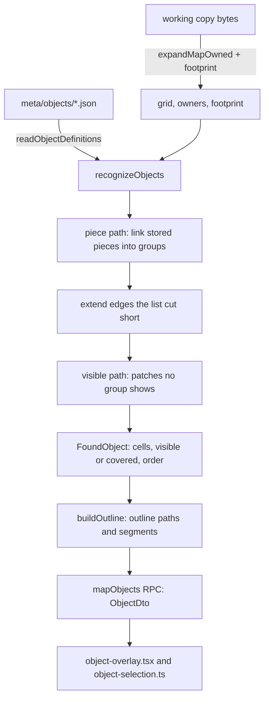

# Finding Objects on a map (#1237)

Round 1 of the Objects design ([#1234](https://github.com/en-gen/hackbench/issues/1234)) is read-only: the
map view finds the project's saved Objects and lets the user select them and their edge segments. Nothing
here writes to the map, the working copy or `ops/`. Words: an **Object**
is a definition, or one placed on a map; a **stored piece** is what the ROM's Layer 1 list holds (the code
calls it an object, `LevelParser.ts`).

Everything in `src/rom/objects/` is plain TypeScript with no shell imports. Claims below are one machine,
the vanilla ROM and the synthetic fixtures named, unless said otherwise.

## Flow

## What is read

- **Footprint.** The owner grid keeps only the last writer of a cell, so a covered Object's own tiles are
  lost to it. `expandMapOwned` takes an optional `footprint` collector: every tile every stored piece wrote,
  overwritten cells included (`claimCell` in `cursor.ts` and `applyWrites` in `interpret.ts`, the only two
  places an owner is claimed). Without a collector the draw path does nothing extra
  (`ExpandFootprint.synthetic.test.ts` proves the grid and owners are identical either way).
- **Map.** `readObjectInputs` expands the map the way `buildL1Inputs` does and keeps what the view
  drops: owners and footprint. A corpus test asserts its grid equals the map view's on `$103`.
- **Definitions.** `meta/objects/<id>.json` in the saved format of #1236. Until that reader merges,
  `src/project/ObjectDefinitionsStandIn.ts` has the same name, signature and return shape; the swap is one import.
- **Slope angle.** From the game's own slope tables (`DATA_00E632` through the acts-like low byte,
  `SlopeResolver.ts`, the same read `TileFactory` makes for `TileCollision.slope`), gated on Mario
  solidity as `TileFactory` does. The class of a tile is its rise over 15 pixels to two places, so the two halves of a
  gentle slope are one angle. No typed slope list.

## Recognition

A definition applies only to maps of its own tileset (the level header's foreground tileset): the same Map16
number is different art on another tileset (acceptance 5).

**The rule (round 1 call 1).** A patch is an Object when it holds at least one edge tile and no edge tile
has patch cells on all four sides. Fill on the outline is fine.

**Piece path.** A piece's cells are the definition tiles in its footprint. Pieces are linked into groups:

1. Two pieces are in contact where 4-adjacent cells have at least one edge tile between them. Fill beside
   fill proves nothing: on `$103` the ground fill piece sits under every platform interior with the same
   tiles, and counting it would glue all four platforms to it. Cells both pieces cover are overlap, not contact.
   (Proven by `fill resting beside fill`: ground under the interior of a one-row platform stays out.)
2. A link counts only when its contact covers at least half of the smaller piece (a wall resting on the
   ground touches one cell of it; an interior beside its edge touches them all).
3. Links are taken best first: an edge beside fill before an edge beside an edge (so two Objects that touch
   side by side do not pair up through their walls), then the share of the longer piece the contact line
   covers, then contact cells, then list order.
4. A link is refused when both groups already hold an edge tile and some piece of one overlaps some piece of
   the other (overlapping pieces are one drawn over another: stacked Objects), or when each part holds the
   rule on its own and the merged shape does not (two Objects that touch). A part that already fails on its
   own, a piece that writes an edge tile into its own body, is merged anyway: the group is broken and does
   not fall apart into fragments (and a broken Object costs only itself, not a whole neighbor). A link that is
   only an edge beside an edge, side by side (the contact line vertical), between two groups that each already
   hold more than one piece and have an edge and fill is refused too: it would join two Objects that touch. A
   wall beside an interior (edge beside fill) is a ledge extended sideways and merges; so does wall on wall above
   and below: a ledge and the continuation of its walls drawn under it is one Object, as the grid says. A group of
   one piece (a cap, a slope) is not yet an Object, so it merges with the ledge it ends. What still merges:
   a ledge and its continuation; one ledge above another, the same width or one tile off, when its body is 1 or 2
   rows tall (90 of 90 cases at each of those heights; w 4-8, 3 offsets, 6 piece orders); a ledge extended
   sideways; a lone edge tile or a one-piece cap or slope beside a wall. At 3 rows or more one ledge above another
   stays two because the wall contact (one cell) covers less than half of a wall piece 3 or more cells tall, so it
   is not a strong link (at an offset of one tile the merged walls are also surrounded). Side by side two whole
   ledges stay two at every height 1-5. Whether the side threshold (`side * 2 >= w`) is the only one that
   works is not pinned: about 18,000 two-ledge placements (w 3-5, h 1-4 each, every non-overlapping offset, 3
   piece orders) give the same result for `>`, `side > 0` and `side === w`.

A cell's tile in a group is the latest group piece's tile, except that a later fill-only piece in no link at
all (it belongs to no Object) drawn over an edge tile replaces it, so a fill piece over a stray edge tile
mends the Object. Such a piece adds no cells, so a mended Object equals the one drawn cleanly, except when the
fill piece also touches an edge piece elsewhere: it then links, is no mender, and the stray edge tile breaks
the Object. Witness: a 5 x 5 platform whose interior writes an edge tile, a fill strip over it running 10 rows
down, and an edge post beside the strip below the platform give one Object of 14 cells; the same visible tiles
drawn cleanly give two, of 14 and 25. [PROP] the mend is outside ordinary grouping; grouping alone would
leave a fill piece over a stray edge tile unmended, and the mending sweeps go red.

**Cut-short edges (call 2).** An edge piece that is one straight run, shorter than the group piece beside
it, is extended to that piece's extent, repeating its end tile, but only through cells another piece draws
over, stopping at the first that is not: over empty sky the list did not cut anything short. The added cells
are covered.

**Candidates and breaking.** A group is a candidate when it passes the rule, holds an edge tile and shows at
least one cell (an Object wholly hidden is never offered). A group that fails the rule is broken: it yields
nothing, and the visible scan does not offer its cells back. A candidate O is also broken (#1234: a
disagreeing tile blocks a match) by a visible edge tile c when c is in O's shape, all four neighbors of c are
in O's shape, c's owner piece is not in another candidate that has fill of its own (a whole Object drawn in
front, such as the next platform of a stack, is not a disagreement), and O is the Object directly behind c:
among the candidates holding c, the one whose latest piece writing c comes last. A lone tile or an edge-only
piece is the disagreement and then follows the ordinary rule as an Object of its own; removing that piece
brings the whole Object back. [PROP] On `$103` the right edge of one platform lies wholly inside another's
body, which is why a front Object with fill breaks nothing. A two-wide front Object (edges only) does break
the one behind it.

**Visible path.** Definition tiles no piece group shows, as 4-connected patches that pass the rule.

**Order.** The largest stored-piece index in the group (later in the list is in front); a visible-path
Object uses the largest owner among its cells.

## Outline and segments

`Outline.ts` takes the cells of a shape and returns two SVG paths and the segments, in map pixels.

- Boundary units are directed clockwise and traced into loops; at a vertex two loops share, the right turn wins.
- A loop splits into segments where it turns a corner (a mushroom's bottom is three). A unit's slope class is
  its owning cell's; a run changes where direction or class changes. Consecutive runs of one slope class that
  alternate between two directions are one `slope` segment, drawn as the staircase, a single slope tile
  included; it is monotone in x and y and holds only edges of slope cells of that angle. A third direction (a
  wall, a corner, the loop seam) starts a new segment, so the floor of slope tiles never wraps round.
- A segment id names where it runs (its first and last point), and cells are sorted first, so ids and the
  Object key (`definition:row:col`, stacked twins told apart by their shape) survive an unrelated edit.
- A boundary unit owned by a covered cell goes to the covered path (drawn dashed).

## The view

- `mapObjects(manifestPath, slot)` returns `ok { objects, skipped }`, `unavailable { reason, detail? }` or
  `rom-not-located` (never a bare boolean, D103). Cached per working-copy bytes for the expanded map; recognition
  reruns each call, so a definition file saved on disk is read the next time the map is read. Nothing watches
  `meta/objects/`: the view reads again on an edit, a ROM change or a reopen. It is separate from `mapScreen`, so the cold
  open is unchanged. The view re-reads it on the existing edit and ROM-change refresh and records `hb:map-objects`.
- `object-selection.ts` holds the pure rules. Hit order: a sprite, then a segment of the selected Object,
  then the front-most Object body. A segment answers only on a selected Object, within half a tile (EDGE_BAND) of its
  outline on either side (the outer half of the edge tile, and just outside it); further in is the Object. Click selects an Object (segments cleared)
  or a segment (plain: just it; Ctrl: toggled among the others); a click on nothing clears. Selecting a sprite
  clears the Object and the reverse. The hover tooltip names the Object.
- `object-overlay.tsx` draws only the hovered and the selected Object: tint as one path, one outline path,
  a dashed covered path, and the hovered or selected segments. Test hooks are listed at the top of the file.

## Refusal

A ROM with a Map16 per level may give a map tiles the finder cannot know, and matching on them would be
wrong, so `objectsRefusal` refuses in plain words unless the Map16 table holds the stock 512 tiles and the
level-load compare at `$05803B` is unhooked. That byte is the Layer 2 background compare (`SMWDisX
bank_05.asm:33`, `CMP.B #$FF`), which Lunar Magic replaces with a jump to its per-level checks; it is a proxy for
"this ROM has been through Lunar Magic's level loader", not a read of any Map16 loader. This is a stand-in until the hacks milestone traces the loader [PROP, approved by Overwatch]. On the corpus
it refuses all five hack ROMs and accepts both vanilla ROMs.

## Limits, stated

- **Edits inside layered Objects (pending the owner).** The counts in this section are asserted exactly by
  `test/suite/unit/ObjectRecognize.limits.test.ts`; they describe what the code does, not what it should do. A lone edge tile dropped into the middle of the
  four-platform stack of `$103` (142 definition cells, one tile at a time) stays an Object of one cell in 94
  cells, and there the Object directly behind it breaks exactly as the rule says (no other platform changes,
  none changes its order). In the other 48 cells the tile touches fill of a neighbor's piece through an edge and
  grouping links it into that platform's edge: 30 leave all four platforms whole, and 18 do not. Of those 18,
  in 6 a platform is its rectangle plus that one tile; in 4 a platform grows by the tile and one extended cell;
  in 4 the tile pulls the 60-cell ground into a platform (84, 100, 150 and 120 cells); and in 4 cells a platform
  drops out (cells (12,10), (20,4), (20,11), (22,4): 10 platforms are missing from the list across those four).
  In 25 of the 29 cells where the platform that shows the cell should break (the cell and its four neighbors
  are in its shape) it does not.
- The same holds for any Object drawn in another's body, not only this stack. A back platform 14 x 10 with a
  front platform 3-5 wide and 2-4 tall at (6,4), and a lone tile at each of the 756 back-interior cells outside
  the front: 648 are correct, 84 keep the back whole, and 24 lose both Objects (the tile links to the front's
  edge and extending that edge down under the back's body makes the front's wall surrounded).
- A piece that holds fill but changes one visible tile (a 1 x 3 piece of fill, edge, fill laid through the
  platform's interior) is shielded as a whole Object in front, so the platform still matches: 180 of 180 cases
  (120 of 120 for the vertical form; w 6-10, h 5-7, every interior position the piece fits). The screen is the same as for the lone tile, which does break it.
  Both are the same limit: what counts as an edit inside layered Objects, and the rule for it, is for the owner.
- A stack of 60 seeded piece orders finds 3 Objects, not 4, in 6 of them: a platform every cell of which a later
  piece covers has nothing to select and is not offered.

- Against the first piece-grouping version on vanilla `$101`-`$13B` (probe definitions, pinned in
  `ObjectRecognize.corpus.test.ts`): the totals match for the ledge definition (76 Objects, 3835 cells) and the
  slope definition (136, 2291); the stress definition differs by one Object (2165 against 2164, 53902 cells both),
  `$127`, where a 38-cell Object is two Objects of 17 and 21 cells: two multi-piece groups that touch edge to edge.
- Grouping is a heuristic over stored pieces. It gets `$103` screen 0 right (four platforms, each its three
  pieces) and is order independent over 60 seeded shuffles of a synthetic stack (up to the platform that a later
  piece wholly hides), but pieces of one Object that
  only touch through fill, or that overlap each other on purpose, split into separate Objects. A
  ground rectangle drawn under and overlapped by a slope piece is not part of the slope's Object.
- Round 1 call 1's rule is the only thing relating tiles to roles; a definition whose edge and fill overlap is
  refused by the reader.
- Measured (the verifier's perf bench medians at `7e0f7b2e`, 20 samples, one machine, one stress definition
  derived from each map's own pieces, vanilla ROM): the largest maps by screens and stored pieces are `$10A`
  (32 screens, 272 stored pieces) and `$125` (32, 233); `$105` (20 screens, 92) is mid-size. Recognize alone:
  `$10A` 5.9 ms, `$125` 2.1 ms, `$105` 4.2 ms. The whole read (expand with footprint, then recognize): 8.3, 4.1 and
  5.1 ms. `app.open-maps` shows no regression against develop. The corpus test bounds only a runaway (2 s); the
  numbers come from the bench ids `core.objects.*`. Acceptance 9 is a measured number: the nightly perf gates are
  paired regressions with no absolute bound, and these ids have no baseline yet, so there is no gate verdict to
  quote. The view's `hb:map-objects` also times the RPC round trip.
