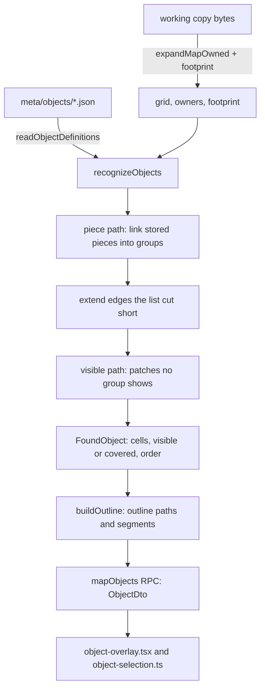

# Finding Objects on a map (#1237)

Round 1 of the Objects design ([#1234](https://github.com/en-gen/hackbench/issues/1234)) is read-only: the
map view finds the project's saved Objects and lets the user select them and their edge segments. Nothing
here writes to the map, the working copy or `ops/`. Words: an **Object**
is a definition, or one placed on a map; a **stored piece** is what the ROM's Layer 1 list holds (the code
calls it an object, `LevelParser.ts`).

Everything in `src/rom/objects/` is plain TypeScript with no shell imports. Claims below are one machine,
the vanilla ROM and the synthetic fixtures named, unless said otherwise.

## Flow

## What is read

- **Footprint.** The owner grid keeps only the last writer of a cell, so a covered Object's own tiles are
  lost to it. `expandMapOwned` takes an optional `footprint` collector: every tile every stored piece wrote,
  overwritten cells included (`claimCell` in `cursor.ts` and `applyWrites` in `interpret.ts`, the only two
  places an owner is claimed). Without a collector the draw path does nothing extra
  (`ExpandFootprint.synthetic.test.ts` proves the grid and owners are identical either way).
- **Map.** `readObjectInputs` expands the map the way `buildL1Inputs` does and keeps what the view
  drops: owners and footprint. A corpus test asserts its grid equals the map view's on `$103`.
- **Definitions.** `meta/objects/<id>.json` in the saved format of #1236. Until that reader merges,
  `src/project/ObjectDefinitionsStandIn.ts` has the same name, signature and return shape; the swap is one import.
- **Slope angle.** From the game's own slope tables (`DATA_00E632` through the acts-like low byte,
  `SlopeResolver.ts`, the same read `TileFactory` makes for `TileCollision.slope`), gated on Mario
  solidity as `TileFactory` does. The class of a tile is its rise over 15 pixels to two places, so the two halves of a
  gentle slope are one angle. No typed slope list.

## Recognition

A definition applies only to maps of its own tileset (the level header's foreground tileset): the same Map16
number is different art on another tileset (acceptance 5).

**The rule (round 1 call 1).** A patch is an Object when it holds at least one edge tile and no edge tile
has patch cells on all four sides. Fill on the outline is fine.

**Piece path.** A piece's cells are the definition tiles in its footprint. Pieces are linked into groups:

1. Two pieces are in contact where 4-adjacent cells have at least one edge tile between them. Fill beside
   fill proves nothing: on `$103` the ground fill piece sits under every platform interior with the same
   tiles, and counting it would glue all four platforms to it. Cells both pieces cover are overlap, not contact.
   (Proven by `fill resting beside fill`: ground under the interior of a one-row platform stays out.)
2. A link counts only when its contact covers at least half of the smaller piece (a wall resting on the
   ground touches one cell of it; an interior beside its edge touches them all).
3. Links are taken best first: the share of the longer piece the contact line covers, then contact cells,
   then list order.
4. A link is refused when both groups already hold an edge tile and some piece of one overlaps some piece of
   the other (overlapping pieces are one drawn over another: stacked Objects), or when the merged shape has
   a surrounded edge tile.

A cell's tile in a group is the latest group piece's tile. For the rule a visibly owned cell uses its grid tile
(out of the shape when that is not a definition tile), a covered one the group's tile.

**Cut-short edges (call 2).** An edge piece that is one straight run, shorter than the group piece beside
it, is extended to that piece's extent, repeating its end tile, but only through cells another piece draws
over, stopping at the first that is not: over empty sky the list did not cut anything short. The added cells
are covered.

**Broken Objects.** The pieces alone decide what is one Object. When the visible tiles then contradict the
rule (an edge tile with fill on all four sides, from a changed tile), the Object is broken: it yields nothing,
and the visible-tile scan does not offer its pieces back as fragments (#1234: a disagreeing tile blocks a match).

**Visible path.** Definition tiles no piece group shows, as 4-connected patches that pass the rule.

**Order.** The largest stored-piece index in the group (later in the list is in front); a visible-path
Object uses the largest owner among its cells.

## Outline and segments

`Outline.ts` takes the cells of a shape and returns two SVG paths and the segments, in map pixels.

- Boundary units are directed clockwise and traced into loops; at a vertex two loops share, the right turn wins.
- A loop splits into segments where it turns a corner (a mushroom's bottom is three). A unit's slope class is
  its owning cell's; a run changes where direction or class changes, and consecutive runs of one slope class
  are one `slope` segment, drawn as the staircase.
- A boundary unit owned by a covered cell goes to the covered path (drawn dashed).

## The view

- `mapObjects(manifestPath, slot)` returns `ok { objects, skipped }`, `unavailable { reason, detail? }` or
  `rom-not-located` (never a bare boolean, D103). Cached per working-copy bytes for the expanded map; recognition
  reruns each call, so a definition file saved on disk is read the next time the map is read. Nothing watches
  `meta/objects/`: the view reads again on an edit, a ROM change or a reopen. It is separate from `mapScreen`, so the cold
  open is unchanged. The view re-reads it on the existing edit and ROM-change refresh and records `hb:map-objects`.
- `object-selection.ts` holds the pure rules. Hit order: a sprite, then a segment of the selected Object,
  then the front-most Object body. A segment answers only on a selected Object, within half a tile (EDGE_BAND) of its
  outline on either side (the outer half of the edge tile, and just outside it); further in is the Object. Click selects an Object (segments cleared)
  or a segment (plain: just it; Ctrl: toggled among the others); a click on nothing clears. Selecting a sprite
  clears the Object and the reverse. The hover tooltip names the Object.
- `object-overlay.tsx` draws only the hovered and the selected Object: tint as one path, one outline path,
  a dashed covered path, and the hovered or selected segments. Test hooks are listed at the top of the file.

## Refusal

A ROM with a Map16 per level may give a map tiles the finder cannot know, and matching on them would be
wrong, so `objectsRefusal` refuses in plain words unless the Map16 table holds the stock 512 tiles and the
level-load compare at `$05803B` is unhooked. That byte is the Layer 2 background compare (`SMWDisX
bank_05.asm:33`, `CMP.B #$FF`), which Lunar Magic replaces with a jump to its per-level checks; it is a proxy for
"this ROM has been through Lunar Magic's level loader", not a read of any Map16 loader. This is a stand-in until the hacks milestone traces the loader [PROP, approved by Overwatch]. On the corpus
it refuses all five hack ROMs and accepts both vanilla ROMs.

## Limits, stated

- Grouping is a heuristic over stored pieces. It gets `$103` screen 0 right (four platforms, each its three
  pieces) and is order independent over 60 seeded shuffles of a synthetic stack, but pieces of one Object that
  only touch through fill, or that overlap each other on purpose, split into separate Objects. A
  ground rectangle drawn under and overlapped by a slope piece is not part of the slope's Object.
- Round 1 call 1's rule is the only thing relating tiles to roles; a definition whose edge and fill overlap is
  refused by the reader.
- Measured (one machine, one stress definition derived from each map's own pieces, vanilla ROM): the largest
  maps by screens and stored pieces are `$10A` (32 screens, 270 pieces) and `$125` (32, 232). Perf bench medians
  (`test/perf/core/objects.bench.ts`): `$10A` recognize 6.8 ms, whole read (expand with footprint, then
  recognize) 12.0 ms; `$125` 4.0 and 7.7 ms; `$105` (20 screens, 88 pieces, mid-size) 6.9 and 10.0 ms. A single
  process: first call on `$10A` 28.6 ms for the read plus 37.8 ms to recognize, then about 8 ms and 15 ms. 60
  synthetic platforms on 20 screens: 15.9 ms. The corpus test bounds only a runaway (2 s); the numbers come from the
  bench ids `core.objects.*`. The view's `hb:map-objects` also times the RPC round trip.
