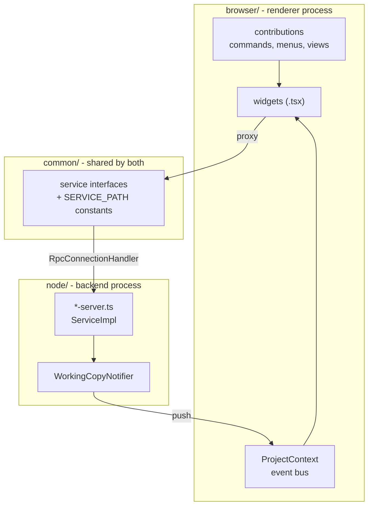
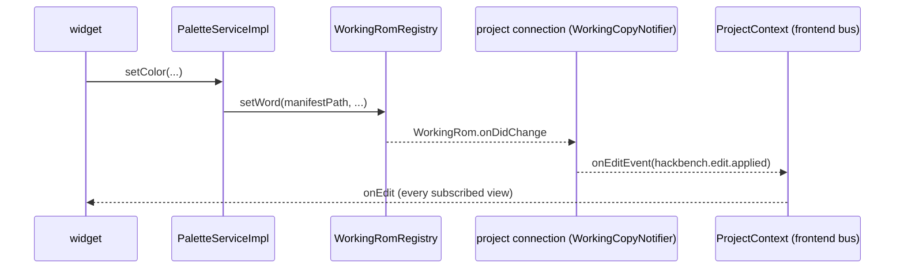

# The Theia shell

`theia/` is the HackBench application. It is a [Theia][theia] monorepo laid
out the way [Composing Applications][compose] describes.

[theia]: https://theia-ide.org/
[compose]: https://theia-ide.org/docs/composing_applications/

```
theia/
  extension/      hackbench-theia-extension, all the actual code
  electron-app/   the desktop target - this is the shipping form
  browser-app/    the same extension in a browser, used by the e2e suite
  no-native/      stubs for native modules the desktop build does not need
```

## Six extensions, one package

`extension/package.json` declares six `theiaExtensions` entries, each a
frontend and backend pair:

| Extension | Frontend                  | Backend         | Service path                   |
| --------- | ------------------------- | --------------- | ------------------------------ |
| hackbench | shell, projects, commands | project server  | `/services/hackbench-project`  |
| palette   | palette view              | palette server  | `/services/hackbench-palette`  |
| music     | audio view (BGM and SFX)  | music server    | `/services/hackbench-music`    |
| gfx       | graphics view             | GFX server      | `/services/hackbench-gfx`      |
| map16     | Map16 tile editor         | Map16 server    | `/services/hackbench-map16`    |
| emulator  | emulator view             | emulator server | `/services/hackbench-emulator` |

Maps have no extension of their own: the project service serves them. A
seventh entry holds the Electron-only OS locale hook. The extensions are
separate because each owns a view, a protocol and a server that can
be reasoned about on its own, not because Theia requires it.

## The three-way split



`common/` is the contract. It holds the service interface and the
`SERVICE_PATH` constant, and it is imported by both sides, so a protocol
change breaks the compile rather than the runtime.

`node/` is the only side allowed to touch the ROM. It imports the core
directly (`src/rom/`, `src/project/`) and decodes on demand.

`browser/` never reads a file. It asks over JSON-RPC and renders what comes
back.

## How a service is wired

hackbench - the only service that pushes to a client - binds its
`ProjectServiceImpl` inside a `ConnectionContainerModule`
(`@theia/core/lib/node/messaging/connection-container-module`), not as a
plain backend-container singleton. Theia gives every top-level connection
(one browser tab, one window) its own CHILD container built from that
module, so each connection resolves its own `ProjectServiceImpl` and its own
client - **this connection's own proxy back to the frontend**, never shared
with another window. `WorkingRomRegistry` is the one thing these still
share: it stays bound in the PARENT container, and the per-connection child
resolves it there, which is what keeps an edit made through one window
visible to every other window and view on the same project.

`palette`, `gfx`, `map16`, `music` and `emulator` have no client (no
`setClient` in their protocol), so they are ordinary backend-container
singletons. They push nothing: an edit they make reaches every view through
the project connection (below).



## Notification paths

This catches people out, so it is worth stating plainly. Everything the
backend tells the frontend leaves on ONE connection, the project service's,
as one of two events, and arrives on one bus, `ProjectContext`. No other
service has a client.

**Edit event** (`ProjectContext.onEdit`). A CloudEvents-shaped envelope
(`src/project/EditEvent.ts`; the `cloudevents` package is imported for its
types only, and ESLint refuses a value import). `type` is
`hackbench.edit.applied` (an edit, a redo) or `hackbench.edit.reverted` (an
undo, or the rollback of an edit that never reached disk). `subject` is the
manifest path. `data` is `{ domain, ranges }`: `domain` is `palette`,
`map16` or `gfx`; `ranges` are half-open `[start, end)` **file offsets** into
the working copy's bytes (a copier header counts; they are not SNES
addresses), coalesced, and empty for a gfx layer, which is addressed by file
and character. Palette and Map16 are told apart by the op's `mask`: Map16
always writes the full word, a colour never carries a mask, and that survives
a reload where a field on the layer would not.

It is built in one place. `WorkingCopyNotifier` is the only
`WorkingRom.onDidChange` subscriber under `theia/extension/src/node`: the
project service's `ProjectConnection` gives every working copy the registry
holds, now or built later (`WorkingRomRegistry.onWorkingCopy`), to its
per-connection notifier, and lets go of a copy the registry replaces.
`watch` is idempotent per `WorkingRom` instance, keyed by a `Map` from that
instance to its unsubscribe function, so a single edit fires the client once.
`setClient(undefined)` (wired to the client proxy's `onDidCloseConnection`)
calls every stored unsubscribe function, so a closed window's dead proxy is
never called again. A palette edit repainting an open GFX sheet is therefore
this one event, not a call between servers.

**ROM changed** (`ProjectContext.onRomChanged`, #576). A separate event with
the manifest path as payload, because it asks a view to rebuild from scratch
where an edit asks it to re-read.
`WorkingRomRegistry.onRomChanged` fires once per project when:

- `relocate` swaps the ROM path (Project Properties);
- `register` serves a project that was waiting for its ROM (the emulator's
  "Locate ROM...");
- a `get` finds the ROM of a project that was waiting for it (it reappeared
  without `register` or `relocate`), so a view stuck on "Locate" refreshes
  (`test/suite/unit/RomChangedEvent.test.ts`);
- a rebuild replaces an existing cache entry (a header flip, or layers
  rewritten under it).

It does not fire on the first build, on a cached read, or on an edit.
`RomChangedNotifier` (per connection, released by `setClient(undefined)`)
pushes it as `ProjectServiceClient.onRomChanged`. This event is deliberately
not a CloudEvent.

| Subscriber                                      | Edit (`onEdit`)                       | ROM changed (`onRomChanged`)                        |
| ----------------------------------------------- | ------------------------------------- | --------------------------------------------------- |
| Palettes explorer                               | rebuild, keeps which groups were open | rebuild as a fresh open: nothing selected, defaults |
| Maps, Graphics, Audio explorers                 | not subscribed (see below)            | rebuild as a fresh open                             |
| Map, Map16, GFX, Palette-group, Overworld views | re-read                               | re-read                                             |
| Emulator, Edit menu                             | stale check / refresh                 | refresh                                             |

The Maps, Graphics and Audio explorers do not subscribe to edits because their
rows come from tables that palette and Map16 word edits do not write, not
because an edit can never matter: a GFX Save may change a GFX file's listing,
and the Graphics explorer picks that up only on its next load. That is a
known gap, not a decision.

## Views

Five views, each with a focus command in the `HackBench` category.
**Maps**, **Graphics**, **Palettes** and **Audio** dock in the left
sidebar; the **Emulator** docks in the bottom panel beside Problems. A
**Properties** panel docks on the right. Placement is each contribution's
`defaultWidgetOptions` in `theia/extension/src/browser/*-contribution.ts`;
read it there. Project-level commands (`New Project...`, `Open Project...`,
`Open Recent Project...`, `Project Properties...`, `Export Patch`) are on the
same category and in the File menu.

Opening another project first closes every GFX, Map16 and map view of the old
one (widgets implementing `ProjectBound`), through the shell so a view with
unsaved strokes asks. The switch aborts if any is still attached afterwards
(a cancelled prompt, or a failed Save), because Theia reports the close as
done either way. A view still loading is disposed when `PreviewTabs` would
attach it (#628). The palette explorer and the music, emulator and overworld
views re-target on `ProjectContext.onChanged`; palette group views close.

Views follow the active Theia theme rather than pinning colors
(`theia/browser-app/test/load-maps.spec.cjs` asserts it).

## The map tab

The map tab draws each screen from `ProjectService` calls, all reading the
working copy through `WorkingRomRegistry`. Rules and evidence for what it
draws are in [level-rendering.md](../rom/level-rendering.md) and
[obj-priority.md](../rom/obj-priority.md); behavior rulings are in
[decisions/](../decisions/README.md). What follows is only the wiring.

| Call | Returns | Node side |
| ---- | ------- | --------- |
| `mapScreen` | six plane canvases per screen, main and sub plane lists, CGADSUB and fixed color; `refusedCells` for the whole map | `map-screen.ts` |
| `mapBeyond` | L2 and L3 planes past the last screen (the gutter) | `map-screen.ts` |
| `mapSprites` | every sprite as one RGBA bitmap in map pixels, with `status`, `unverified`, `priority` and a `note` | `map-sprites.ts` |
| `mapSpriteFrames` | the other poses of one sprite, for Properties | `map-sprites.ts` |
| `mapBlockContents` | item-block art and where each block shows which | `map-block-contents.ts` |
| `mapCollisionCheck`, `mapCollision` | whether the probe can run; floor, ceiling, wall and unknown polylines | `map-collision.ts` |

The widget runs `composeScreen` (`src/rom/model/ColorMath.ts`) on every layer
toggle, so layer 3 and SNES color math draw on every non-Mode-7 level mode
(#562). The plane canvases stay in the DOM as the compositor's source, never
seen.

- **Sprites (#564, #795, #879, #981).** A sprite is not cut at screen edges
  (parts sit at anchor plus `dx`/`dy`), so `mapSprites` is separate from
  `mapScreen`; the frontend cuts it per screen (`compositeSpriteScreen`). Each
  pixel keeps its OAM priority and composites at that priority's mode 1 slot
  (`spritePlanes`, `screenPlanes`). A sprite pixel a nearer tile covers draws
  through the hidden-tile screen door (D52, `spriteDoors`); hovering a sprite
  lifts its door (`doorIdAt`) and shows its name (`spriteAt`, Theia's
  `HoverService`). The `S` toggle hides the sprite canvases.
- **Quiet marker (#1011).** A sprite the game's loader never runs as a sprite (shooter,
  generator, scroll command), or whose run drew nothing, is `status: 'quiet'`: a 16 x 16
  ring and dot at the placed spot, `kind` naming the loader path, door 0 (never dithered),
  hit anywhere in its box, words from `quietText`. The routing comes from `loadClasses`
  (`LoadClass.ts`), which runs the ROM's own sprite-list routine once per ROM version and
  caches by the bytes read; when it cannot read the ROM an empty run keeps the framed box,
  marked unverified. The failure box (`placeholder`) stays for refusals, unloaded chars,
  extra bits and no descriptor.
- **Block content indicators (#566).** A screen that holds an item block gets
  a display canvas (`IndicatorDisplay`, `map-view-model.ts`) that recomposes
  the indicator's cell at the zoom; the native composite is never given
  indicators. Hiding a layer hides its indicators.
- **Collision overlay (#435).** `src/rom/collision/` runs SMW's own block code
  on the 65816 core, so a patched block routine shows (vanilla block code
  only for now). One SVG in map coordinates (`browser/collision-overlay.tsx`),
  scaled by `ZoomController`. Nothing is probed until the toggle is pressed; a
  cold map costs about 3 s of CPU, then probe results are cached by
  working-copy bytes, tileset, game state and tile id. An edit keeps every
  cached entry whose ROM and seed reads it did not touch
  (`ProbeCache.validate`). A map the probe cannot run answers `unavailable`
  with a reason, which becomes the disabled toggle's tooltip. The overlay
  follows the palace and blue P-switch toggles; the silver P-switch is not
  modelled. Method and evidence: `spikes/collision-probe/README.md`.
- **Refused objects (#816, #1005).** Layer 1 objects the expander refuses draw
  nothing; `refusedCells` (`src/rom/model/RefusedCells.ts`) marks each one's
  anchor cell in a red dashed SVG (`browser/refused-overlay.tsx`) listing every
  distinct reason, with a count badge for 2 or more. Test hooks:
  `data-control="refused-overlay"`, `refused-cell`, `refused-badge`.
- **Toggles.** `MapViewStateStore` (`map-view-state-store.ts`) holds the palace
  and switch toggles per tab as a flux-style store: buttons `dispatch`, the
  store fires `onDidChange` once per real change, and the toolbar, layer 1 and
  the collision overlay each react. Layers, grid and the collision toggle are
  still widget fields.

### The map strip's pad (#1004)

Content the data places off the map (a refused-object cell, a sprite's placement
cell: `stored`, else its anchor) must draw where the data names it, so `offMapPad` (`browser/off-map-extent.ts`)
is the one place the canvas grows: per side, the content extent rounded up to
whole 16 px tiles. Art past an edge from a placement on the map is cut and
grows nothing (#1325); only a sprite whose box touches neither the map nor its
placement cell also counts its `box` (D52). At the far end only (right of a horizontal map, bottom of a
vertical one) a fixed 256 px gutter (`GUTTER_PX`) is added beyond it, except
on a 32-screen map (`MAX_SCREENS`), which cannot grow. There is no gutter
before position 0. Rulings: D76 call 2, D145 and
[2026-11-04-map-gutter-far-end-only.md](../decisions/2026-11-04-map-gutter-far-end-only.md).

Everything that turns a pointer or scroll offset into a map position
subtracts the leading pad; `mapOrigin()` is the same value as a point. Over
the pad the widget:

- fades the back color to transparent across the gutter (`fadeMask`);
- draws off-map sprite pixels on one canvas (`data-layer="off-map-sprites"`);
- continues layers 2 and 3 through the gutter from `mapBeyond`
  (`data-layer="gutter-layers"`;
  [2026-11-05-gutter-layers-through-band.md](../decisions/2026-11-05-gutter-layers-through-band.md));
- runs the grid across it, and marks where the map ends (#1296, D194): a 3 px amber
  `#ffc23d` line over a 5 px dark edge (`data-control="map-end-line"`), centered on the
  far edge from `farEdge` (screen count x screen size, so it never moves for content
  past the end or for the canvas end) and constant in screen px at every zoom. Its
  z-index (1001) is above the gutter layers (110), off-map sprites (120), the collision
  overlay (200) and the grid canvas (1000), whose 5 px screen-boundary line it must not dim
  (nothing else in the grid host stands above 1000)
  (evidence: `map-end-line.spec.cjs`, computed z-index and pixels, one machine, Chromium
  via the Theia browser app). Its colors are `--theia-hackbench-*` variables with literal
  fallbacks (no ColorContribution in this repo). `data-control="map-edge"` stays as the map's rectangle,
  with no outline. A 32-screen map has no gutter: the line is drawn inset
  (`hb-inset`, its outer side on the edge) so all 5 px stay inside the strip;
- fills the last gutter screen (`addScreenRect`) with a dashed "Add screen" outline
  (`data-control="add-screen"`), inert until adding screens exists (#26, #950): default
  cursor, no hover style, a plain-word tooltip, and it swallows clicks so nothing
  under it selects. Proposed calls:
  [2026-11-13-map-end-line-and-add-screen.md](../decisions/2026-11-13-map-end-line-and-add-screen.md).

When a sprites reply grows the pad, `keepViewOnPadChange` refits and restores
the view. Evidence: `map-off-map-canvas.spec.cjs` (Fit, same map pixel under
the center within 1 px, one machine, Chromium via the Theia browser app). The
reference extension has no off-map canvas, so there is nothing to port.

## Properties view (#984)

One right-hand panel, `hackbench.properties` (View > Properties), showing a
subject held by `PropertiesModel` (`properties-model.ts`): `none` or `sprite`
today. A map tab publishes as its own owner and only the owner's clear takes
effect, so closing a background map never wipes the front map's sprite.

It is a small `ReactWidget`, not `@theia/property-view`, which would lose the
owner rule. It reads only the `MapSpriteDto` the map view draws from, via the
pure `sprite-props.ts`; nothing re-reads the ROM and nothing writes.

Animation is on demand: `mapSpriteFrames(manifestPath, mapIndex, spriteIndex)`
reruns that one sprite with the map's seed and camera and blits later passes
through `drawSprites` (no second draw path), capped at 16 poses and deduped by
each part's char, flips and offset. `FramePlayer` (`sprite-frames.ts`) steps
every 133 ms. One pose says "Not animated"; none says "Animation not shown"
plus a reason. Evidence: vanilla ROM, one machine (`SpriteFrames.test.ts`).
To add the map description (#1023): add a `map` variant to
`PropertiesSubject`, publish it from the map widget, and call
`registerSubjectRenderer('map', ...)` in `properties-widget.tsx`.

## The emulator view

The emulator runs a **libretro core that you supply**. HackBench ships no
core. The path to it is registered per machine, beside the ROM registry and
for the same reason: two contributors point at different local builds of the
same core, so it is never a project value.

A single entry rather than a map, since only one core drives the view at a
time, and the path is re-validated on every resolve.

The view is honest about its preconditions: with no project open it asks for
one, and with no core registered it offers to locate one.

## Running it

```bash
yarn --cwd theia install
```

```bash
yarn --cwd theia build
```

```bash
yarn --cwd theia start
```

`build` and `start` target Electron. The browser target is
`build:browser` and `start:browser`, which is what the Playwright suite
drives.

Type-checking the shell is a separate script from the root:

```bash
npm run typecheck:theia
```

It runs `tools/scripts/typecheck-theia.cjs`, which checks
`theia/extension/node_modules/typescript`, then `theia/node_modules/typescript`,
never searches ancestor directories, follows junctions at those two paths, and
passes extra arguments through. A fresh worktree needs
`yarn --cwd theia install --frozen-lockfile --ignore-scripts` first (it needs TypeScript in `theia/extension/node_modules` or
`theia/node_modules`); without it the script exits 1 and says so (#669).
`test/suite/gates/typecheckTheia.test.ts` covers the hint, the compiler
choice, path resolution, argument and exit-status pass-through with stub
compilers.

## Drag and drop

Found on the map groups work, PR #562, 2026-09-25. `[EST]`

- Theia's shell calls `preventDefault` on every `dragover` on the page (for file drops). Skipping it on a refused target does not show a no-drop cursor; set `dataTransfer.dropEffect = 'none'` explicitly. `event.defaultPrevented` is useless as a test signal.
- Playwright: drag with the real pointer, as `theia/browser-app/test/map-groups.spec.cjs` does (`startDrag`, `hoverDragOver`): `mouse.down` on the source row, a short `mouse.move` past the browser drag threshold, `mouse.move` onto the target row, then `mouse.up`. Playwright routes it through Chromium's own drag pipeline, so the dragenter, dragover and drop events and the `DataTransfer` are the browser's. `locator.dragTo` is not used on the virtualized `TreeWidget`.
- Synthetic `DragEvent`s dispatched on the rows passed while the real drag did nothing (#625): a constructed `DataTransfer` ignores writes to `dropEffect`. Do not use them.
- Read the widget's own verdict while hovering (`canDrop`) and assert the tree is unchanged after a refused drop.
- Theia stamps `data-node-id` on the expansion toggle too; select `.theia-TreeNode[data-node-id=...]`.

## Related reading

- [overview.md](overview.md) - how the shell relates to the core
- [codebase-map.md](codebase-map.md) - what tests cover this tree
