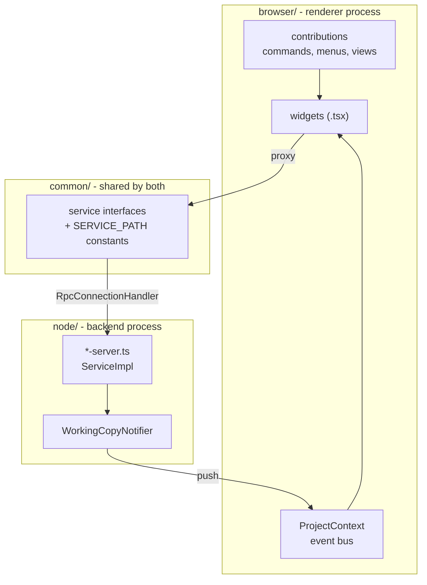
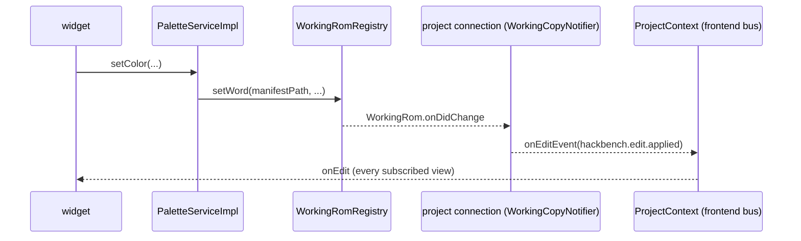

# The Theia shell

`theia/` is the HackBench application. It is a [Theia][theia] monorepo laid
out the way [Composing Applications][compose] describes.

[theia]: https://theia-ide.org/
[compose]: https://theia-ide.org/docs/composing_applications/

```
theia/
  extension/      hackbench-theia-extension, all the actual code
  electron-app/   the desktop target - this is the shipping form
  browser-app/    the same extension in a browser, used by the e2e suite
  no-native/      stubs for native modules the desktop build does not need
```

## Six extensions, one package

`extension/package.json` declares six `theiaExtensions` entries, each a
frontend and backend pair:

| Extension | Frontend                  | Backend         | Service path                   |
| --------- | ------------------------- | --------------- | ------------------------------ |
| hackbench | shell, projects, commands | project server  | `/services/hackbench-project`  |
| palette   | palette view              | palette server  | `/services/hackbench-palette`  |
| music     | audio view (BGM and SFX)  | music server    | `/services/hackbench-music`    |
| gfx       | graphics view             | GFX server      | `/services/hackbench-gfx`      |
| map16     | Map16 tile editor         | Map16 server    | `/services/hackbench-map16`    |
| emulator  | emulator view             | emulator server | `/services/hackbench-emulator` |

They are separate because each owns a view, a protocol and a server that can
be reasoned about on its own, not because Theia requires it.

## The three-way split



`common/` is the contract. It holds the service interface and the
`SERVICE_PATH` constant, and it is imported by both sides, so a protocol
change breaks the compile rather than the runtime.

`node/` is the only side allowed to touch the ROM. It imports the core
directly (`src/rom/`, `src/project/`) and decodes on demand.

`browser/` never reads a file. It asks over JSON-RPC and renders what comes
back.

## How a service is wired

hackbench - the only service that pushes to a client - binds its
`ProjectServiceImpl` inside a `ConnectionContainerModule`
(`@theia/core/lib/node/messaging/connection-container-module`), not as a
plain backend-container singleton. Theia gives every top-level connection
(one browser tab, one window) its own CHILD container built from that
module, so each connection resolves its own `ProjectServiceImpl` and its own
client - **this connection's own proxy back to the frontend**, never shared
with another window. `WorkingRomRegistry` is the one thing these still
share: it stays bound in the PARENT container, and the per-connection child
resolves it there, which is what keeps an edit made through one window
visible to every other window and view on the same project.

`palette`, `gfx`, `map16`, `music` and `emulator` have no client (no
`setClient` in their protocol), so they are ordinary backend-container
singletons. They push nothing: an edit they make reaches every view through
the project connection (below).



## Notification paths

This catches people out, so it is worth stating plainly. Everything the
backend tells the frontend leaves on ONE connection, the project service's,
as one of two events, and arrives on one bus, `ProjectContext`. No other
service has a client.

**Edit event** (`ProjectContext.onEdit`). A CloudEvents-shaped envelope
(`src/project/EditEvent.ts`; the `cloudevents` package is imported for its
types only, and ESLint refuses a value import). `type` is
`hackbench.edit.applied` (an edit, a redo) or `hackbench.edit.reverted` (an
undo, or the rollback of an edit that never reached disk). `subject` is the
manifest path. `data` is `{ domain, ranges }`: `domain` is `palette`,
`map16` or `gfx`; `ranges` are half-open `[start, end)` **file offsets** into
the working copy's bytes (a copier header counts; they are not SNES
addresses), coalesced, and empty for a gfx layer, which is addressed by file
and character. Palette and Map16 are told apart by the op's `mask`: Map16
always writes the full word, a colour never carries a mask, and that survives
a reload where a field on the layer would not.

It is built in one place. `WorkingCopyNotifier` is the only
`WorkingRom.onDidChange` subscriber under `theia/extension/src/node`: the
project service's `ProjectConnection` gives every working copy the registry
holds, now or built later (`WorkingRomRegistry.onWorkingCopy`), to its
per-connection notifier, and lets go of a copy the registry replaces.
`watch` is idempotent per `WorkingRom` instance, keyed by a `Map` from that
instance to its unsubscribe function, so a single edit fires the client once.
`setClient(undefined)` (wired to the client proxy's `onDidCloseConnection`)
calls every stored unsubscribe function, so a closed window's dead proxy is
never called again. A palette edit repainting an open GFX sheet is therefore
this one event, not a call between servers.

**ROM changed** (`ProjectContext.onRomChanged`, #576). A separate event with
the manifest path as payload, because it asks a view to rebuild from scratch
where an edit asks it to re-read.
`WorkingRomRegistry.onRomChanged` fires once per project when:

- `relocate` swaps the ROM path (Project Properties);
- `register` serves a project that was waiting for its ROM (the emulator's
  "Locate ROM...");
- a `get` finds the ROM of a project that was waiting for it (it reappeared
  without `register` or `relocate`), so a view stuck on "Locate" refreshes.
  Evidence scope: `WorkingRomRegistry.get()` keeps the waiting marker until the
  copy is built; synthetic ROMs on one machine, pinned by two tests in
  `test/suite/unit/RomChangedEvent.test.ts` ("a waiting project served by a
  later get() is announced once, and a later register adds nothing" and "a
  waiting project whose layer is unreadable keeps waiting; the get that
  finally builds it fires once"), each seen red against the code without the
  behaviour;
- a rebuild replaces an existing cache entry (a header flip, or layers
  rewritten under it).

It does not fire on the first build, on a cached read, or on an edit.
`RomChangedNotifier` (per connection, released by `setClient(undefined)`)
pushes it as `ProjectServiceClient.onRomChanged`. This event is deliberately
not a CloudEvent.

| Subscriber                                      | Edit (`onEdit`)                       | ROM changed (`onRomChanged`)                        |
| ----------------------------------------------- | ------------------------------------- | --------------------------------------------------- |
| Palettes explorer                               | rebuild, keeps which groups were open | rebuild as a fresh open: nothing selected, defaults |
| Maps, Graphics, Audio explorers                 | not subscribed (see below)            | rebuild as a fresh open                             |
| Map, Map16, GFX, Palette-group, Overworld views | re-read                               | re-read                                             |
| Emulator, Edit menu                             | stale check / refresh                 | refresh                                             |

The Maps, Graphics and Audio explorers do not subscribe to edits because their
rows come from tables that palette and Map16 word edits do not write, not
because an edit can never matter: a GFX Save may change a GFX file's listing,
and the Graphics explorer picks that up only on its next load. That is a
known gap, not a decision.

## Views

Five views, each with a focus command in the `HackBench` category.
**Maps**, **Graphics**, **Palettes** and **Audio** dock in the left
sidebar; the **Emulator** docks in the bottom panel beside Problems, so it
can sit below whatever you are editing.

Each view's side and ordering is its contribution's
`defaultWidgetOptions`, in `theia/extension/src/browser/*-contribution.ts`.
Read it there rather than trusting this paragraph: the emulator moved from
the main area to the right sidebar in #472, then to the bottom panel.
Project-level commands (`New Project...`, `Open Project...`, `Open Recent
Project...`, `Project Properties...`, `Export Patch`) live on the same
category and are reachable from the File menu.

Opening another project first closes every GFX, Map16 and map view of the old one
(the widgets that implement `ProjectBound`), through the shell so a view with
unsaved strokes asks. The switch aborts if any such view is still attached
afterwards (a cancelled prompt, or a Save that failed), because Theia reports
the close as done either way. A view still loading during the switch is
disposed when `PreviewTabs` would attach it (#628). The palette explorer and
the music, emulator and overworld views re-target on `ProjectContext.onChanged`;
palette group views close themselves there.

The map tab shows each screen as one composite canvas. The backend sends the
six plane canvases per screen plus two plane lists (main and sub, bottom to
top) and the CGADSUB and fixed color; the widget runs `composeScreen`
(`src/rom/model/ColorMath.ts`) over them on every layer toggle, so layer 3 and
the SNES color math draw on every non-Mode-7 level mode (#562). The plane
canvases stay in the DOM as the compositor's source, never seen. Rules and
evidence: `docs/rom/level-rendering.md`.

Views follow the active Theia theme rather than pinning their own colors,
which `theia/browser-app/test/load-maps.spec.cjs` asserts.

### The map tab's block content indicators (#566)

`ProjectService.mapBlockContents(manifestPath, index)` returns the distinct
16 x 16 item arts of a map (`arts`, by key) and where each item block shows
which (`indicators`: plane, map-pixel corner, art key), from the working copy,
with a plain-words `note` for blocks it does not draw. The tables' refusal
comes back as `unavailable` and the tab shows the reason.
The composite canvas of each screen stays native-size and is never given indicators. A screen that
holds one also has a display canvas (`data-layer="display"`) over it, which hides the composite and shows
the same picture at the zoom (`IndicatorDisplay`, `browser/map-view-model.ts`): the native composite
scaled up, with each indicator's block cell recomposed at the zoom, its planes scaled by nearest
sampling, its plane's indicators painted into the plane's copy and the planes stacked and put through
color math as ever. So hiding a graphics layer hides its indicators, and a nearer plane or a sprite covers an
indicator exactly as it covers its block. A hidden plane is left out of the plane set, not empty. A hover
change recomposes only the cells it touches (about 2 ms at 3x on a screen with three blocks, measured in
node), and the display is built once per screen and zoom. Screens with no indicator show the composite
itself. Hover is tracked on the scroller (`onPointerMove`, and re-found on scroll, zoom and new replies);
the topmost visible plane's block under the pointer expands. The display publishes the boxes it painted
in `data-indicators`.

### The map tab's sprite layer (#564)

`ProjectService.mapSprites(manifestPath, index)` returns every
sprite of a map as one RGBA bitmap in map pixels (`MapSpriteDto`: index, id,
anchor, `box`, base64 `rgba`, `status` of `drawn` or `placeholder`, and the
reason a marker is a marker: the interpreter's refusal (`refused: ...`), an
empty run (`drew no OAM tile`), or `extraBits` / `charsNotLoaded`), plus the
screen size and orientation. A drawn sprite may carry `unverified`: the level
loader refused this ROM, so the sprite ran from a placement-only seed, not the
level's state. The reply's `note` joins two caveats: the stream has no end
marker in the bytes read (sprites past them are not drawn), and, once per map,
that sprites were drawn unverified; the tab shows it.
`node/map-sprites.ts` is the pure module behind it; `project-server.ts`
reads the working copy through `WorkingRomRegistry`, as `mapScreen` does.
It is a separate call from `mapScreen` because a sprite is not cut at screen
edges: parts sit at the anchor plus the engine's `dx`/`dy`, negative and off
the 16 px grid. The frontend cuts each bitmap per screen
(`compositeSpriteScreen`, `browser/map-view-model.ts`) into one `sprites`
canvas per screen, stacked just under L1's priority plane. The `S` toggle
hides those canvases with `visibility: hidden`, as L1 and L2 do.
Each drawn sprite also carries `priority`, one byte per pixel: the OAM
priority (attribute bits 5:4) of the part that wins the pixel (#795). The
composite does not use the canvas: `spritePlanes` splits each screen's
sprites into `sprites0` to `sprites3`, which `screenPlanes` places at their
mode 1 slots ([obj-priority.md](../rom/obj-priority.md) section 5).
A sprite pixel a nearer tile covers draws in the hidden-tile screen door (D52):
`spriteDoors` returns, per screen, a `Uint32Array` of `sprite id << 1 | parity`
on the sprite's own pixel grid, passed to `composeScreen` as `doors`. The swap
decision per id (`doorFlips`) is counted over the whole native screen; a
caller that composes a crop or a scaled cell passes the native result as
`flips`. `IndicatorDisplay` does this: it scales `doors` with each cell
(nearest) and reuses the native flips, so a covered sprite pixel under an
indicator cell keeps its door at any zoom. Main screen only.
Hover (#879): the widget finds the sprite under the pointer with `doorIdAt`
(the door id at the native pixel) and passes it as `lift` to `composeScreen`
and `IndicatorDisplay`; that sprite's covered pixels draw opaque. The lift is
part of the composite's cache key for the screens whose door map holds the id, so a lifted frame is never kept as the normal one and other screens do not repaint. The id is global to the map, so a sprite crossing a screen edge lifts on each screen it reaches; a sprite with no covered pixel on any composed screen never lifts.

Sprite label (#981): `MapSpriteDto.name` is filled node-side from
`getSpriteMetadata(id)?.displayName` (the sprite name table in
`src/rom/model/sprites/SpriteMetadata.ts`); an id the table lacks has none and
gets no hover. `spriteAt` (`map-view-model.ts`) returns the sprite that
owns an opaque map pixel, using the same `stackOrder` as `spriteLayer`, so the
named sprite is the one drawn on top. The widget asks Theia's `HoverService`
for a hover whose text is `spriteName` (the name only), placed against an
invisible fixed box over the sprite, so it takes the editor hover theme
colours; there is no native `title` and nothing in the status bar. Leaving
the sprite, a sprite reload, the sprite toggle going off or closing the tab
cancels it.

### The map tab's collision overlay (#435)

`ProjectService.mapCollision(manifestPath, index)` returns a map's collision as
tagged polylines in map pixels (`MapCollisionResult`: `width`, `height`, and
`lines` of `kind` `floor`, `ceiling`, `wall` or `unknown`; an unknown line is
the cell's closed outline). The lines come from SMW's own block collision run
on the 65816 core (`src/rom/collision/`), not from `TileFactory.classify`, so a
patched block routine would show; vanilla block code only for now.
`node/map-collision.ts` is the pure module behind it; `project-server.ts` reads
the working copy through `WorkingRomRegistry` and passes a `cancelled` check
(the working copy's bytes moved on), so a probe for old bytes stops between
tiles. It is a separate call from `mapScreen`: a cold map takes about 3 s of
CPU (the probe yields to the event loop after every tile), then a revisit is a
cache hit. Probe results are cached per working-copy bytes by tileset, game
state and tile id; the composed reply per bytes and map (eight kept).

A map the probe cannot run answers `unavailable` with the reason (the ROM's
level loader refused it, or the level is vertical): the toolbar's
`collision-toggle` is then disabled with that reason as its tooltip, never an
empty overlay. Nothing is probed until the toggle is pressed: on map open the
view calls the cheap `mapCollisionCheck` (the level's shape and the ROM's own
level loader, no tile probed), which decides the toggle's state; `mapCollision`
runs on the press and on every working-copy push while the overlay is on. With
it off, an edit only drops the stale lines and the next press refetches. Replies
to an older request are dropped by `generation`, as for sprites.

The overlay (`browser/collision-overlay.tsx`) is one SVG inside the strip, in
map coordinates, so it follows `ZoomController` by scaling its box.
`vector-effect: non-scaling-stroke` keeps every line 2 CSS px wide. Surfaces
(`#ffeb3b`) and walls (`#d500f9`) are separate `<g data-group>` elements;
unknown cells are hatched. The overlay follows the view's four palace toggles and the blue P-switch
(`mapCollision` takes the same flags as `mapScreen`: the grid is built with them, since $06A-$06D
become $16A-$16D on 48 levels, and the probe's WRAM gets $1F27-$1F2A and $14AD to match). The silver
P-switch also changes tiles ($12F becomes coin $2B under it) but is not modelled, so the overlay does
not follow it; ON/OFF swaps chars, not tiles, so it does not matter here. Mario is small. The state is
in the composed reply's key. The per-tile probe cache, calibration and level-of-air runs key on the
tileset and the blue P-switch only, not the palaces: on vanilla the block code reads the palace flags
only in the big palace switch (bank_00.asm:12508), whose two branches give the same collision, so a
palace toggle reuses every cached tile and probes only the ids new to the map ($015 yellow: 1 tile, about
20 ms warm, against re-probing the whole map). The probe records any read of $1F27-$1F2A (even though it sets them), and an entry that read them is cached per
palace state, so a hack whose blocks read the flags stays right after a toggle. Before probing, the ROM's call
sites into the two collision routines are byte-checked (`entryProblem`, bank_00.asm:11723-11771): a hook that
reroutes them refuses with a reason, in the toggle's check as well as the probe.

An edit does not empty the probe cache. Each cached result (tile, calibration, level-of-air runs) keeps
the ROM bytes its runs read and the seed-WRAM bytes it read before writing them, with the values seen.
`mapCollision` gives new working-copy bytes the previous bytes' cache, owing the diffed byte ranges;
the next probe of a tileset (`ProbeCache.validate`) drops only entries whose ROM reads meet those ranges
or whose seed reads differ in the freshly loaded seed. The grid and compose always re-run on the new
bytes, so moving tiles in level data re-probes only ids new to the map (about 40 ms on $105), and a
byte only one tile's code reads drops the tiles sharing it (a few ms to a fraction of a second);
a byte the level-of-air runs read drops everything. Seed level data is a dependency only if a run read it. Tile results are otherwise reused across levels
of a tileset without a per-level check (until an edit, when seed reads are compared): that rests on the
cross-level test and a sweep of 800 level pairs with no wrong result, not on a check per level. Evidence:
vanilla, $105, a sequence of twelve moves and byte edits, each equal to a cold probe.

The toggles live in `MapViewStateStore` (`browser/map-view-state-store.ts`, over the Theia-free
`map-view-state.ts`), a per-tab flux-style store on Theia's `Emitter`: the buttons only `dispatch`
(`togglePalace`, `toggleSwitch`), the store replaces its state and fires `onDidChange({ state,
changed })` once per real change, and three consumers decide for themselves. The toolbar re-renders for
`aria-pressed`; layer 1 refetches the screens in view; the collision overlay follows `collisionPlan`:
a palace or blue P-switch change drops its lines and any reply still on the way, asks again if the
overlay is on, and, if the toggle was disabled by a probe's refusal for the old state, runs the cheap
check again (a refusal is tied to its state key; only the cheap check's refusals are the map's). Lines
are kept with the key they were probed for and drawn only for the current one. On the server a newer
state asked for the same map stops the older probe at its next tile. Layers, grid and the collision
toggle are still widget fields.

The probe's calibration and level-of-air runs come from the first level probed on a tileset, then
serve every later level of that tileset (checked identical on $105/$1C6; $105 and $111 differ, so
tileset is in every cache key). Command `hackbench.maps.toggleCollision` is enabled only while a map
tab is focused and its toggle is usable (`canToggleCollision`, the button's own test), in
`grid-toggle-contribution.ts`.

### The map tab's refused-object overlay (#816)

Layer 1 objects the expander refused draw nothing, so the tab marks where they are. `refusedCells`
rides on every `mapScreen` reply (whole map, absent when none), built in `buildL1Inputs`
(`src/rom/model/RefusedCells.ts`): one cell per object, since one object can be refused twice
(handle_0DB49E), with the gate reason winning over the unported one. The overlay
(`browser/refused-overlay.tsx`) is one SVG in map coordinates, scaled by `ZoomController` like the
collision overlay. Cells are red, dashed and marked "!", unlike the collision overlay's orange hatched
unknown cells. Z-order is 150: above the screens, below the collision lines (200). It is hidden
while the tab shows a screen error, so no marks sit on a blank strip.

Only the anchor cell (the parser's x,y) is marked: a refused object's footprint is unknown, and a
guessed rectangle would be [PROP]. The cell keeps the object's own x,y at any distance, inside the map
or off it: it is never clamped (D76 call 2, D145) and never dropped (D52), and the canvas grows to hold it,
see "The map strip's pad" below.

Test hooks: `data-control="refused-overlay"` (absent when there are no cells), per cell
`data-control="refused-cell"` with `data-x`, `data-y` (tiles) and `data-object`, and the reason
`Object <n> (<type>): <why>` as both the `<title>` tooltip and the `aria-label`.

### The map strip's pad (#1004)

Owner rulings: D76 call 2 ("draw it off the map where the game indicates it is drawn. the canvas can and
should extend beyond the map bounds"), D48 part 2 ("half a screen width of gutter on each end with ui to
add a screen. The background should fade in a gradient to the edges"), D145 ("no matter what. the user
needs ways to extend the size of the map") and R24 (the back color fades to transparent in the gutter).

`offMapPad` (`browser/off-map-extent.ts`, pure) is the one place the canvas grows. Per side, the pad is
the content the data places off the map there (a refused-object mark's 16 px cell, a sprite's `box`),
rounded up to whole 16 px tiles, so the grid runs on across it on the same lattice. At each LONG end (left
and right of a horizontal map, top and bottom of a vertical one) a fixed 128 px gutter (`GUTTER_PX`, half a
256 px screen) is added BEYOND that content, always, even when nothing is off the map; the short sides get
the content alone, no gutter and no extra margin. The "add screen" control (#950, D69) will sit in a gutter.

The pad is derived from the layout (marks) and the sprites reply together and memoized by both, so it can
change when the sprites arrive (`keepViewOnPadChange`, below). It is read from one getter, `pad`, by every
consumer, and `mapOrigin()` (protected, map pixels: `{x: pad.left, y: pad.top}`; same name, signature and
units as #977's neighbor-card hook) is the same value as a point.

With the pad the widget:

- pads `.hb-map-view-strip` by the pad times the zoom, so the screens keep their place relative to the map;
- paints the back area over the whole strip as a gradient along the scroll axis (`backGradient`, "to right"
  on a horizontal map, "to bottom" on a vertical one): the map's back color, solid across the map and
  across any content band, and fading linearly to transparent over the 128 px gutter only, which starts
  beyond the content. A band the content grew on a SHORT side is not a gutter and stays solid [PROP];
- draws the refused SVG in a user space whose origin is the MAP origin (`viewBox` starts at the negative
  left/top pad), so marks off the map land where the data names them;
- draws the sprite pixels that fall outside the map on one canvas (`data-layer="off-map-sprites"`, z 120).
  The pixels inside the map stay with the screens, under the tiles' priority. The canvas spans the whole
  padded strip rather than the pad bands (simpler) and is mounted only when `offMapSpritePixels` returns
  pixels, so a map whose sprites all lie inside it has no such element. Like the refused overlay it is not
  drawn while the tab shows a screen error;
- confines the checkerboard (`.hb-checkerboard`, "nothing here") to the strip without the 128 px gutters, so
  where the back color fades out the panel shows behind it, not the checkerboard [PROP];
- marks the map's edge with a 1 px outline (`data-control="map-edge"`) [PROP], and runs the grid
  (`MapGridOverlay`, `map-grid.ts` `pad`) on across the pad.

Everything that turns a pointer or scroll offset into a map position subtracts the leading pad: hover
(`updateHover`), click selection and the hover anchor of a sprite (#981, #984; the anchor adds the pad back),
`liftAt` (positions off the map never lift: no tile covers a sprite there), `visibleScreens`
(`screensInView`) and `placeStart` (`centerScroll`), both unit-tested on the arithmetic. A scroll window wholly
in a pad touches no screen, and no screen outside the map is ever requested (a request for one would set a
screen error that sticks). Fit's cross axis
includes the short-side pads (`measureFit`). A newly opened map still scrolls to the player's start
(`placeStart` centers it, lead included), so the leading gutter shows only when the start is near the map's
beginning.

When a sprites reply grows the pad, `keepViewOnPadChange` refits and restores the view: the map pixel under
the view center is recorded before the change and the scroll set absolutely after the refit commits (an
axis at scroll 0 is left alone), skipped when the map was reopened or the user zoomed in between;
`.hb-map-view-scroller` sets `overflow-anchor: none` so the browser does not shift it as well. Evidence:
the Playwright case in `map-off-map-canvas.spec.cjs` (Fit, same map pixel under the center within 1 px, one
machine, Chromium via the Theia browser app); not a proof for every zoom or reply order.

What vanilla does (a sweep of the 488 maps that build, one machine, vanilla ROM, with `offMapPad` at this
commit over every sprite `box` and refused cell; vanilla refuses no object): 14 maps have content off the
map, the other 474 (including $105 and $109) are padded by the gutters alone. Content pad beyond the
gutter, in px:

| map                                                | content (sprite ids)                      | left | right | bottom |
| -------------------------------------------------- | ----------------------------------------- | ---- | ----- | ------ |
| $C4 $EB $F0 $FB $1DA $1E6 $1E7 $1F9 (ghost houses) | $8D door, box starts 8 px left of the map | 16   | 0     | 0      |
| $DD                                                | $63, 8 px left                            | 16   | 0     | 0      |
| $F8                                                | $E2                                       | 0    | 32    | 16     |
| $0E, $110                                          | $9E                                       | 0    | 0     | 16     |
| $1B                                                | $AD                                       | 0    | 0     | 16     |
| $102                                               | $5D, $A4 (24 px below)                    | 0    | 0     | 32     |

Add 128 on the left and right (the gutters) to read the pad itself; a bottom pad has no gutter.

Sharing the space with #977: its neighbor cards sit in bands that are siblings of the scroller and are
positioned from `mapOrigin()`, while the gutters are inside the strip, so the two never overlap. The "add
screen" control (#950) goes in a gutter.

The reference VS Code extension has no off-map canvas: its map editor pans with padding that is clamped
to the map (`src/webview/mapEditor/main.ts:301`), so there is nothing to port.

## Properties view (#984)

One right-hand side panel, `hackbench.properties`, reopened from View > Properties. It shows a SUBJECT held by
`PropertiesModel` (`properties-model.ts`): `none` or `sprite` today. A map tab publishes as its own owner and
only the owner's clear takes effect, so closing a background map never wipes the front map's sprite. Clicking a sprite publishes it and reveals the panel without
activating it; empty ground, hiding or closing the map clears it to "No sprite selected".

It is a small `ReactWidget`, not `@theia/property-view`: that package is not a dependency and adding it churns
the lockfile for a selection-service round trip that would lose the owner rule. Everything it shows comes from
the `MapSpriteDto` the map view draws from (`parts` is filled by `drawSprites` from the same list that blits the
bitmap), via the pure `sprite-props.ts`; nothing re-reads the ROM and nothing writes.

Animation: `mapSprites` still ships one pose per sprite (the interpreter's `chosen` pass). The panel asks for the
rest on demand through `mapSpriteFrames(manifestPath, mapIndex, spriteIndex)`: the node side runs that one sprite
again with the map view's seed and camera, and blits every pass that draws through `drawSprites` (no second draw
path). `Machine.passes` are consecutive game frames. The loop starts at the pass the map shows (`chosen`, so frame
0 is the map's bitmap) and goes on to later passes, kept in pass order and capped at 16. The sprite's own movement
is subtracted (from `pos`, or from `origin` for a $67 on a vanilla-shaped handler, whose parts are measured from the
pass before), then poses are deduped by each part's char, flips and offset from the other parts, so parts that
move against each other are a new pose and whole-sprite drift is not. One pose says "Not animated"; no frames at
all says "Animation not shown" plus a plain reason (the node and player keep reason codes, `framesReasonText`
puts them in words). Sprites with screen-fixed parts (`fixOffsets`) are not animated, because that fix is only
derived for the chosen pass. `FramePlayer` (`sprite-frames.ts`) requests on selection, drops replies and errors
for an older selection, steps every 133 ms (8 game frames) and stops its timer on clear, hide and dispose. The
widget follows the model through `followSubject` (`properties-follow.ts`), which applies the current subject
first: a click publishes BEFORE the reveal command creates the widget. Evidence scope: vanilla ROM, one machine; a Koopa ($04)
yields at least 2 frames across maps $0C7 and $105, a $9F at most 1 (`SpriteFrames.test.ts`). Known follow-ups: no keyboard
selection of a sprite yet, and `parts` now rides on every drawn sprite in the `mapSprites` reply.

Adding the map description (#1023): add a `map` variant to `PropertiesSubject`, publish it from the map widget
where it now publishes `none`, and call `registerSubjectRenderer('map', ...)` in `properties-widget.tsx` (the
renderer registry; `render()` does not change); the sprite breadcrumb in `SpriteSubject` is where "Back" goes.

## The emulator view

The emulator runs a **libretro core that you supply**. HackBench ships no
core. The path to it is registered per machine, beside the ROM registry and
for the same reason: two contributors point at different local builds of the
same core, so it is never a project value.

A single entry rather than a map, since only one core drives the view at a
time, and the path is re-validated on every resolve.

The view is honest about its preconditions: with no project open it asks for
one, and with no core registered it offers to locate one.

## Running it

```bash
yarn --cwd theia install
```

```bash
yarn --cwd theia build
```

```bash
yarn --cwd theia start
```

`build` and `start` target Electron. The browser target is
`build:browser` and `start:browser`, which is what the Playwright suite
drives.

Type-checking the shell is a separate script from the root:

```bash
npm run typecheck:theia
```

It runs `tools/scripts/typecheck-theia.cjs`, which checks
`theia/extension/node_modules/typescript`, then `theia/node_modules/typescript`,
never searches ancestor directories, follows junctions at those two paths, and
passes extra arguments through. A fresh worktree needs
`yarn --cwd theia install --frozen-lockfile --ignore-scripts` first (it needs TypeScript in `theia/extension/node_modules` or
`theia/node_modules`); without it the script exits 1 and says so (#669).
`test/suite/gates/typecheckTheia.test.ts` covers the hint, the compiler
choice, path resolution, argument and exit-status pass-through with stub
compilers.

## Drag and drop

Found on the map groups work, PR #562, 2026-09-25. `[EST]`

- Theia's shell calls `preventDefault` on every `dragover` on the page (for file drops). Skipping it on a refused target does not show a no-drop cursor; set `dataTransfer.dropEffect = 'none'` explicitly. `event.defaultPrevented` is useless as a test signal.
- Playwright: drag with the real pointer, as `theia/browser-app/test/map-groups.spec.cjs` does (`startDrag`, `hoverDragOver`): `mouse.down` on the source row, a short `mouse.move` past the browser drag threshold, `mouse.move` onto the target row, then `mouse.up`. Playwright routes it through Chromium's own drag pipeline, so the dragenter, dragover and drop events and the `DataTransfer` are the browser's. `locator.dragTo` is not used on the virtualized `TreeWidget`.
- Synthetic `DragEvent`s dispatched on the rows passed while the real drag did nothing (#625): a constructed `DataTransfer` ignores writes to `dropEffect`. Do not use them.
- Read the widget's own verdict while hovering (`canDrop`) and assert the tree is unchanged after a refused drop.
- Theia stamps `data-node-id` on the expansion toggle too; select `.theia-TreeNode[data-node-id=...]`.

## Related reading

- [overview.md](overview.md) - how the shell relates to the core
- [codebase-map.md](codebase-map.md) - what tests cover this tree
