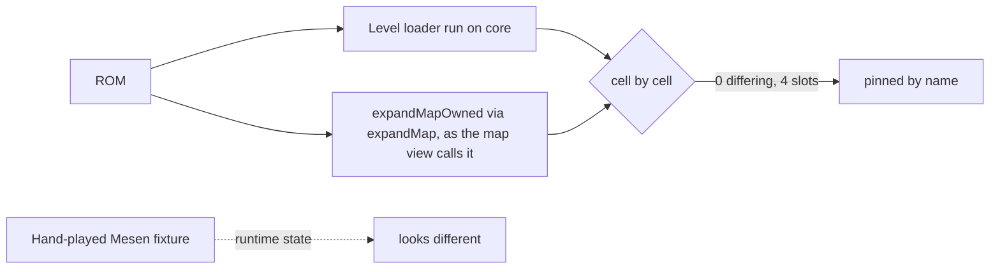

# Map diff family #141, #144, #149, #150

> **Bottom line**
>
> - On vanilla, the map view's expander equals the ROM's own level loader on slots $1FE, $0E7 (vertical), $1EF and $1E3: 0 differing cells each. Across all 512 slots, the 11 vertical maps included, the only differences are the 21 boss-arena maps already pinned (576 cells). `[EST]` unit tests, vanilla ROM, one machine. The pin does not tell the interpreter path from hand ports: hand ports alone also give 0 differing cells on these four slots, so it guards the agreement, not which implementation produced it. `[EST]`
> - The September map-diff fixtures were hand-played Mesen dumps that carry runtime state (hit blocks, collected items). The cells they disagree on are mostly explained by blocks the player hit. `[INF]` from the fixture tooling below and the per-cell chains.
> - There is no expansion fix. This work pins the agreement (`test/suite/unit/sprites/levelStateVsExpander.test.ts`). `[EST]`
> - Not explained: $1FE column 72, rows 19-22. No vanilla writer of the needed value was found. `[OPEN]` a clean headless capture of $1FE would settle it.

| Source                          | Identifier                                                                                                                                                                       | As of      | Retrieved  |
| ------------------------------- | -------------------------------------------------------------------------------------------------------------------------------------------------------------------------------- | ---------- | ---------- |
| ROM's own level loader on core  | `src/rom/sprites/interp/LevelLoader.ts`, CODE_05801E (`bank_05.asm:20-70`)                                                                                                       | 2026-11-13 | 2026-11-13 |
| Expander as the map view calls  | `src/rom/model/L1Model.ts:246` calls `expandMapOwned`; `expandMap` is a pass-through to it (`ObjectExpander.ts:253-275`), and the test calls `expandMap` with the same arguments | 2026-11-13 | 2026-11-13 |
| Hardware oracle (indirect)      | `CaptureGate.corpus.test.ts` against layers_v5, 143-map roster                                                                                                                   | 2026-11-13 | 2026-11-13 |
| Hardware capture (direct, $1EF) | `captures/d31-sample/1ef`, headless, Mario never moved                                                                                                                           | 2026-11-13 | 2026-11-13 |
| Disassembly                     | SMWDisX, cited per line below                                                                                                                                                    | 2026-11-13 | 2026-11-13 |

## 1. Oracle used, and why

The Mesen fixtures for these four slots no longer exist on this machine. layers_v5 marks all four UNREACHABLE (low byte $00 or $DC-$FF, so OverworldOverride cannot address them). So the grade is the ROM's own level loader, run on the core, compared cell by cell with the expander.

- Result: 0 differing cells on $1FE, $0E7, $1EF and $1E3. `[EST]` vanilla ROM, one machine.
- Layout used for the comparison: horizontal `bank_00.asm:6595-6628, 13295-13310`; vertical `bank_00.asm:13322-13340`. The offset function has ROM-free unit tests. `[EST]`
- Indirect hardware chain: `CaptureGate.corpus.test.ts` passes against layers_v5 on the 143-map roster (14 passed, 0 skipped; only $0C3 is a known difference, #570). `[EST]` one machine.
- Direct hardware for $1EF: `captures/d31-sample/1ef` (headless, Mario never moved) has 0 differing cells over 2592. `[EST]`
- Mutation proof: swapping the vertical offset for the horizontal one turns the $0E7 pin red; corrupting one loader cell inside the per-slot path turns all four named pins red. `[EST]` 2026-11-13.

## 2. How the September fixtures were made

A hand-played Mesen session ran `tools/mesen/l1_dump.lua` (NORMAL and AUTO-SCROLL modes, a dump every 20 frames). `tools/scripts/stitch_map16_dumps.py` stitched the dumps, keeping for each cell the tick where Mario was closest. So a block Mario hit, or an item he collected, stays changed in the result. `[EST]` from the tool sources.

## 3. Cells where the fixture differed from the loaded map

The fixture tile ids come from red boxes and pixel matching on the September issue diff images (rendered by `gen_diff_images.ts`, CI run 35418455599). A pixel match shows the same picture, not that the id is the same. `[INF]`

Columns: cell (col, row), loaded tile, fixture tile, writer, status. Tiles are Map16 numbers.

### $1FE

- Row 24, cols 17-19 and 134-137 (7 cells): match today: the ids the loader writes now are pixel-equal to the September fixture picture. The commit that fixed them was not identified. `[EST]` pixel comparison only; `[OPEN]` which change fixed it.
- Col 72, rows 19-22: loaded $11E (turn block, object 37, standard $09), fixture $048 by pixel match. **UNEXPLAINED.** `[OPEN]`
  - $048 is index 5 of TileToGeneratePg0 (`bank_00.asm:7389-7390`), reached by GeneratedTiles entry 05, "always turning block" (`bank_00.asm:7302`, entry at 7307). An extended object $20 route through DATA_0DA548 (`bank_0D.asm:1449-1456`) is the other candidate; $48 sits at index $10 of that table (`bank_0D.asm:1452`), and the mapping from ext $20 to that index was not traced. That table path is not used by $1FE in any case.
  - No vanilla writer of $9C=5 was found. Checked: the bounce end table DATA_00F0C8 (`bank_00.asm:12765-12770`), TileFromBounceSpr1 (`bank_02.asm:2292-2315`), MushrmScaleTiles (`bank_02.asm:13378`), GrowingPipeTiles1 and 2 (`bank_02.asm:13815-13819`), and the Magikoopa magic (MagikoopasMagic, `bank_01.asm:8205`; it sets $9C=2 at `bank_01.asm:8260-8262`, which is the "nothing" tile $25, not $048).
  - The same object at (45, 14) matches the loader. `[EST]`

### $1EF, $1E3 and $0E7: hit from below

One chain covers the cells below. A block hit from below gets end value $0D from DATA_00F0C8 (`bank_00.asm:12765-12770`); CODE_00F17F (`bank_00.asm:12846-12860`) spawns a bounce sprite; an ordinary hit loads the bounce sprite's tile (`bank_02.asm:2277`) and branches to TileFromBounceSpr1, which stores it in $9C (`bank_02.asm:2292-2293`); the $0D itself comes from DATA_00F0C8 indexed by the block's tile minus $111 (`bank_00.asm:12827-12855`), and the load at `bank_02.asm:2287` is only the multi-coin path (CODE_0291AA), and calls GenerateTile (`bank_02.asm:2315`). GeneratedTiles routes $0D to CODE_00C0C4 (`bank_00.asm:7431-7455`), which takes TileToGeneratePg1 index $0D minus 9 = 4 and sets the high bit, giving $132 (`bank_00.asm:7425-7426`). `[EST]` read from the disassembly.

| Slot | Cell      | Loaded | Fixture | Status                                                               |
| ---- | --------- | ------ | ------- | -------------------------------------------------------------------- |
| $1EF | (15, 14)  | $121   | $132    | explained by the chain; d31 capture (no hit) matches the loaded tile |
| $1E3 | (13, 20)  | $125   | $132    | explained by the chain                                               |
| $0E7 | (11, 104) | $120   | $132    | explained by the chain                                               |
| $0E7 | (12, 104) | $124   | $132    | explained by the chain                                               |
| $0E7 | (8, 37)   | $124   | empty   | plausible only, see below                                            |
| $0E7 | (3, 69)   | $11E   | empty   | plausible only, see below                                            |

The two "empty" cells: either the shatter path, CODE_028752 (`bank_02.asm:902-926`, $9C=2 at 924-925; entered from `bank_00.asm:12912` and `12965`), or collection, which sets $9C=1 (`bank_00.asm:13126-13129`). The fixture does not tie either cell to a hit. `[INF]` plausible, not shown.

## 4. What would settle the rest

A clean headless capture of $1FE and $0E7 through a screen-exit route, taken the way `d31-sample/1ef` was. That would settle the $1FE column 72 cells and the two $0E7 "empty" cells against hardware. `[OPEN]`
