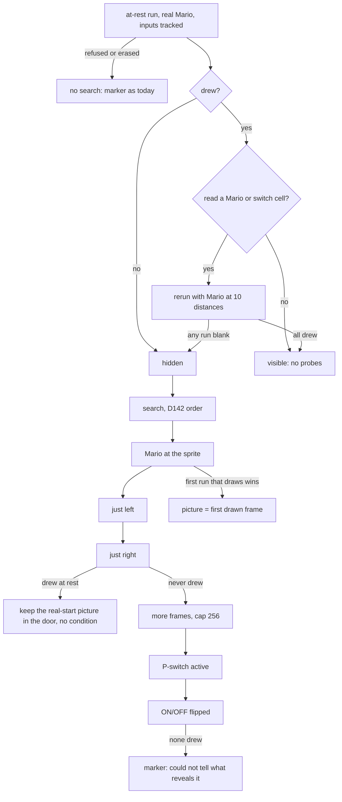

# Hidden sprites: the reveal search (#1132)

A sprite whose code draws only on a condition draws nothing in the at-rest run (D139 D). The map shows it
anyway, drawn where it would appear and through the screen door, with a tooltip that says what shows it. This is
how the app finds out, from the ROM's own code and not from a list of sprite ids.

Evidence scope: derived from SMWDisX and run on the synthetic cart in CI. The $105 sample (vanilla, one machine) is in
the PR, not here.

## The flow

## What is run

- The first condition, `mario-at-sprite`, puts Mario's position on the sprite's. The tooltip says "gets close to this spot": a mole wakes on a low-byte distance window and a Blargg at about 112 px either side, so "touches" was true only for a sprite that tests Mario's box.

- Every rerun is the same `runOnce` with `atRest`, so the picture's position is the one the at-rest path gives
  (placed spot, parts measured from where the pass ended). The trigger's own movement (the invisible mushroom's
  rise) is therefore not shown. Until #1231 lands, a hidden sprite whose INIT moves it is drawn at the placed spot,
  as every sprite is.
- Mario is fed, never drawn: small ($19 Powerup = 0), on foot ($72 PlayerInAir = 0), not on Yoshi
  ($187A PlayerRidingYoshi = 0). The tooltip says so.
- Mario's probe position is written after INIT (`SpriteSeed.marioMain`), so INIT sets the facing from the
  level entrance's Mario, as at rest. The left and right conditions never change the facing. A sprite that sets its
  facing in MAIN follows the probe's side; that is a limit, not a claim.
- P-switch is `BluePSwitchTimer` $14AD, ON/OFF is `OnOffSwitch` $14AF (rammap.asm:1665-1667, SMW_U.sym). The
  flipped value is the loaded image's, xor 1.
- A sprite that rewrites its own number ($9E) is followed: the game's sprite loop dispatches whatever number is in
  $9E each frame (CallSpriteMain reads it, `SpriteRunner` runs that loop), so the runner only checks the new number's
  MAIN pointer is code (`resolvePointer`) and refuses with a reason when it is not.
- Created sprites do not count as drawing (D106A): the probes keep only the OAM entries written while `$15E9` is
  the sprite's own slot (`parts` are own-only in every run since #840; the rest are `companions`).

## Shortcuts and the third outcome

- The at-rest run is tracked (`RunOptions.trackInputs`: cells read before written). A sprite that drew and never read
  Mario's position, his fixed state, `$14AD` or `$14AF` is visible with no probe reruns: every probe would repeat it.
  A blank sprite always goes to the search.
- The more-frames, P-switch and ON/OFF reruns start from the real Mario. For a sprite that drew from the real start
  they would draw the same frame and call it a reveal, so they run only for a sprite that never drew.
- A sprite that drew from the real start, is blank under some probe, and no Mario position reveals keeps its real-start
  picture, drawn in the screen door, with the hover "is not always there, and the app could not tell what hides it".
  No condition is claimed (`none-found`). A sprite that never drew under any run is the marker, reason `unrevealed`.
- The door: the sprite's door id carries `WHOLE_DOOR` (ColorMath), so `composeScreen` draws every pixel at the door's
  strength through the existing door map, `doorFlips` counts its swap over all its pixels, and the hover lift (#879)
  makes it solid wherever it is.

## Why ten distances

Montys test only the low byte of Mario's distance: `SubHorizPos` stores `PlayerXPosNow - SpriteXPosLow`
(bank_01.asm:6124-6129; the high-byte subtraction only feeds the sign), and the mole adds $60 and compares with
$C0 (bank_01.asm:13341-13346). The window is 192 of every 256 low-byte values, so the sprite is blank in a 64 wide band
that repeats every 256 px, and a probe at 0 or at 256 sees it drawn. Eight probes spaced $20 apart leave no gap wider
than 32, so the band cannot fall between two; $180 and -$180 (low byte $80) cover a sprite that only needs Mario
near. The test `RevealSearch.test.ts` shows 0 and 256 alone miss it, for sprite positions on both sides of the band.

## Limits

Interpreter limits (dynamic graphics, unmodelled registers) refuse the run as before and a refused run is never
searched. A sprite no condition shows keeps a marker with the reason `unrevealed`. Revealed sprites are listed by
`npm run sprite:report -- --reveal --map <hex>`, which also lists the sprites that drew at rest and are now hidden.
