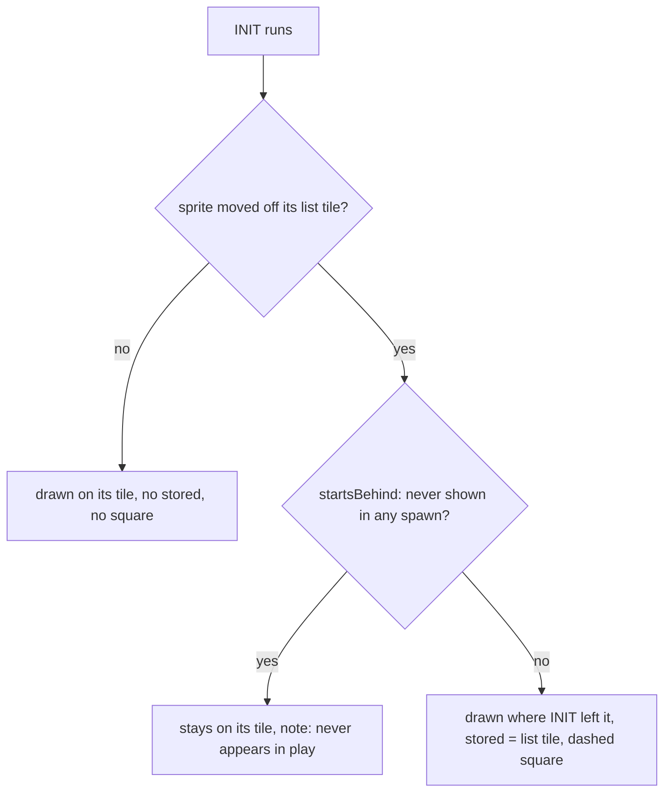

# INIT moves at rest: every sprite draws where its setup code puts it (#1231)

The map view runs a sprite's INIT and MAIN on the 65816 core (`SpriteRunner.runOnce`, `atRest`) and draws the first pass that puts a tile in OAM. Since #1231 the drawing stands where INIT left the sprite, for every sprite. The list entry stays the sprite's data (`anchor.rawX`, `rawY`), is sent as `stored` for any sprite drawn off it, and the map outlines it with a dashed square (#1176). Decision: `docs/decisions/2026-11-14-sprites-draw-where-their-code-puts-them.md`.

- The offset is whatever INIT did: no id list, no per-sprite offset. MAIN's own motion in the pass stays out of the picture (the pass-origin rule of #1131); a line-guided id is drawn where the game first has it on its line (D156).
- A sprite that lays out its own sprites at fixed map positions (`absolutePlacement`, D158) is unchanged.
- A moved sprite the sprite loader never shows stays on its stored tile (`neverAppears`, D156, now for every moved sprite). That needs positive evidence in every spawn the loader allows: its parts, or with nothing drawn its own position, behind the scroll edge, or the sprite erased. An empty run alone is not evidence: the game culls what GetDrawInfo's window leaves out, and on a vertical map the loader spawns a sprite 288 px below or 48 px above the camera, outside that window (`bank_02.asm:5217-5238`).
- The square shows only when the drawing's box does not cover the whole stored cell (`storedSquares`, `map-view-model.ts`).

## How many move, and by how far (vanilla ROM, 512 maps, one machine, 2026-11-14)

3239 sprites compared; 410 drawn off their stored tile, 371 of them with a dashed square (the drawing does not cover the whole stored cell); 24 maps give no sprite reply ($95-$9B, $CC, $D5, $D9, $DF, $E2, $E5, $195-$19B, $1C7, $1DE, $1EB, $1F6). The stored position of every compared sprite equals its list entry.

| Sprite | Count | Offsets from the stored tile (x, y) |
| ------ | ----- | ----------------------------------- |
| $0E | 20 | 8, 0 |
| $26 | 31 | 8, 0 |
| $29 | 6 | -72, 224 or 240 (writes) |
| $2A | 8 | 8, -17 |
| $33 | 72 | 0, 64 to 224 (11 values) |
| $3C | 6 | 0, 1 |
| $4B | 9 | 8, -1 |
| $4F | 56 | 8, -1 |
| $50 | 8 | 8, -1 |
| $52 | 8 | 0, -1 |
| $5B | 5 | 0, 16 |
| $5D | 13 | 0, 16 |
| $5F | 9 | 120, 104 |
| $62 | 4 | 0, 15 / 0, 5 / 15, 0 |
| $63 | 1 | 0, 15 |
| $65 | 25 | 0, 15 / 15, 0 / 15, 15 / 31, 0 / 31, 15 |
| $66 | 1 | 31, 0 |
| $67 | 17 | 0, 15 / 15, 15 / 16, 15 / 31, 0 / 31, 15 |
| $68 | 37 | 15, 0 / 15, 15 / 16, 79 / 26, 0 / 26, 15 / 31, 0 / 31, 15 / 31, 4 |
| $6C | 23 | -8, 0 |
| $A4 | 16 | 0, 16 / 0, 8 |
| $AC | 17 | 0, -64 |
| $C0 | 18 | 0, 2 |

The line-guided rows ($62-$68) are the shape D156 already drew; the rest are new. Large moves ($5F, $33, $29, $AC) are the ones the owner would notice first. $29 (InitKoopaKid, `bank_01.asm:10489-10533`) does not move: it writes its own absolute X and Y, so the offset is from the list tile to where the write lands. The only sprites marked "never appears in play" on these maps are line-guided ones; none of the others is.
